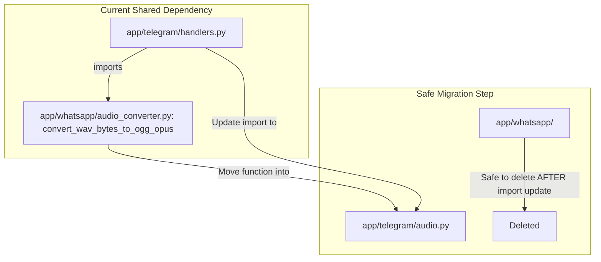
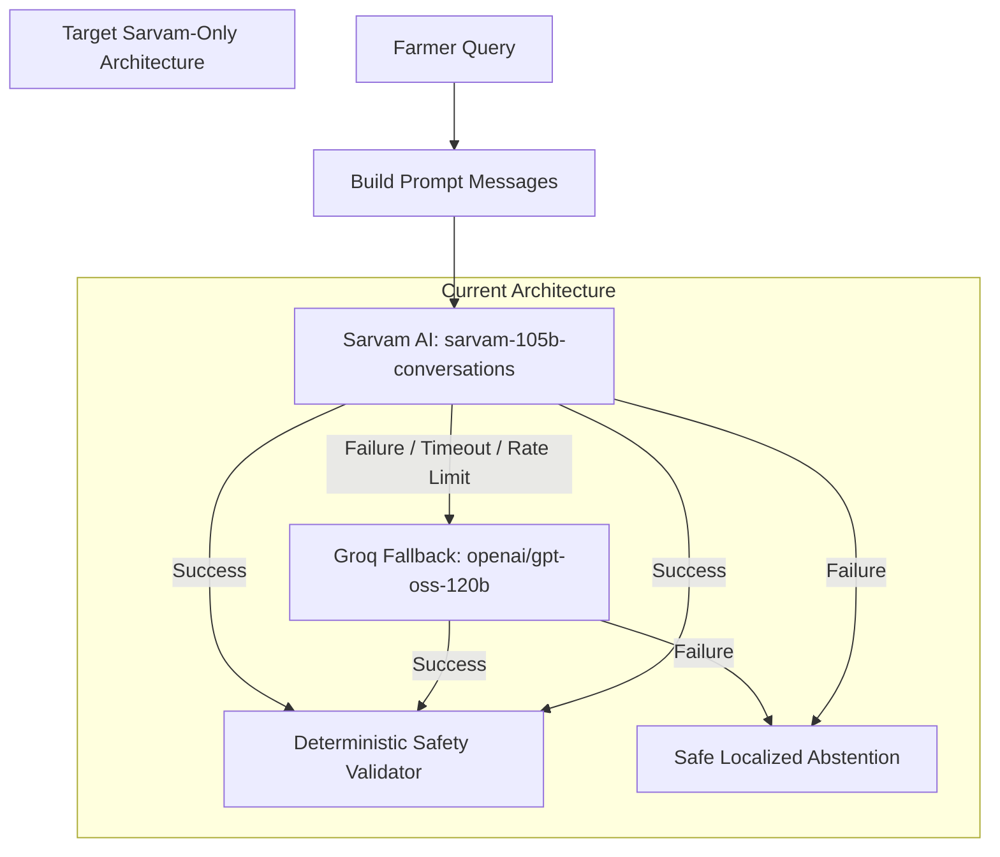

# KrishiVaani — Stage 1: Complete Project Audit and File Inventory

**Audit Date:** 2026-11-12
**Repository Path:** `D:\Sid_Folder\Sid_projects\Gnani_Project`
**Deployment Platform:** Railway (Backend Telegram Polling Bot), Netlify (Marketing Frontend)
**Status:** **Strictly Read-Only Audit Complete.** Zero application files modified, zero database records altered, zero git commits or pushes executed.
**Audit Scope:** 100% full-codebase inspection of all 198 project files, hidden configurations, legacy modules, dependency trees, and persistent database state.

---

> [!NOTE] Architecture Clarification (Dated 2026-11-12)
> While this Stage 1 audit originally documented an exploratory proposal to remove Groq, the definitive production architecture decision confirmed on November 12, 2026 mandates **Sarvam AI (`sarvam-105b-conversations`) as the Primary LLM** with **Groq (`openai/gpt-oss-120b`) preserved as the mandatory automatic fallback**. Groq is invoked strictly upon qualifying provider-level failures (network timeouts, rate limits, 5xx server outages) and shares identical deterministic agricultural safety validation. The historical findings below are preserved as recorded during the initial Stage 1 inspection.

## 1. Architecture Audit & Comparison

### Current vs. Final Architecture

| Architectural Layer | Current Technology (Audit Baseline) | Final Architecture Requirement (Target State) | Audit Status & Delta |
|---|---|---|---|
| **User Interface** | Telegram Bot (`@KrishiVaaniBot`) & Meta WhatsApp / Twilio Sandbox | **Telegram Bot Only** | WhatsApp/Twilio are inactive in production; ready to decommission. |
| **Speech-to-Text (STT)** | Gnani Prisma v3.0 (`gnani-vachana==0.9.0`) | **Gnani Prisma v3.0** | Preserved. Enforces <= 30.0s voice audio. |
| **Primary Reasoning LLM** | Sarvam AI (`sarvam-105b-conversations`) | **Sarvam AI Only** | Configured as primary in settings. Must eliminate Groq fallback. |
| **Secondary / Fallback LLM** | Groq (`openai/gpt-oss-120b`) | **NONE (No Secondary Provider)** | Groq fallback exists in `app/llm/service.py:195-207`; must be removed. |
| **Text-to-Speech (TTS)** | Gnani Timbre v2.5 (Kaveri voice, `te-IN`) | **Gnani Timbre v2.5** | Preserved. 16kHz WAV encoded to mono OGG Opus for voice notes. |
| **Audio Processing** | FFmpeg via system binary & `imageio-ffmpeg` | **FFmpeg** | Preserved. Critical shared dependency identified in `app/whatsapp/`. |
| **Agricultural Knowledge RAG** | SQLite-backed PJTSAU & TGDPS advisories | **SQLite Agricultural RAG** | Preserved. 51 knowledge records (50 verified seasonal advisories + 1 approved permanent reference) strictly gated. |
| **Weather & Warning Feed** | WeatherAPI & IMD Telangana District Alerts | **WeatherAPI & IMD Alerts** | Preserved. 30-min location TTL and explicit consent gating. |
| **Database Engine** | SQLite (`/app/data/krishivaani.db`) | **SQLite** | Preserved. Railway volume at `/app/data`. |
| **Hosting & Container** | Railway (`python -m app.telegram.run`) | **Railway** | Preserved. Long-polling daemon inside Docker container. |
| **Marketing Website** | Netlify (`https://krishivaani1.netlify.app/`) | **Netlify** | Preserved. Independent frontend repository deployment. |

---

## 2. Critical Sarvam Requirement Audit

The audit specifically inspected the reasoning pipeline across `app/core/config.py`, `app/llm/service.py`, and `app/llm/providers/`:

1. **Configured Sarvam Model ID:** `sarvam-105b-conversations` (defined in `app/core/config.py:30` and `app/llm/providers/sarvam_provider.py:38`).
2. **Sarvam REST API Endpoint:** `https://api.sarvam.ai/v1/chat/completions` (`ENDPOINT` in `app/llm/providers/sarvam_provider.py:28`).
3. **Provider Implementation:** Persistent `httpx.Client` calling Sarvam's OpenAI-compatible completions endpoint with `temperature=0.2`, `max_tokens=900`, and structured JSON mode (`app/llm/providers/sarvam_provider.py:46-85`).
4. **Current Fallback Trigger:** In `app/llm/service.py:195-207`, when `LLM_PROVIDER="sarvam"`, if `SarvamProvider.generate_completion()` raises any `LLMError` or unhandled `Exception`, the service automatically intercepts the failure and invokes `_try_groq_fallback(request, messages, e)`:
   ```python
   # app/llm/service.py:195-207
   try:
       raw_response = self.provider.generate_completion(messages=messages, json_mode=True)
   except LLMError as e:
       if isinstance(self.provider, SarvamProvider):
           return self._try_groq_fallback(request, messages, e)
   ```
5. **Secondary Provider Elimination Plan:**
   - Modify `app/llm/service.py`: Eliminate `GroqProvider` import and `_try_groq_fallback()`. On Sarvam failure, directly invoke `_create_error_abstention(request, error_code, str(e))` to deliver a localized Telugu/Hindi/English apology and AO/KVK referral.
   - Modify `app/core/config.py`: Remove `GROQ_API_KEY`, `GROQ_MODEL_ID`, and `GROQ_REASONING_EFFORT`.
   - Modify `requirements.txt`: Remove `groq==0.37.1`.
   - Remove `app/llm/providers/groq_provider.py`.

---

## 3. Complete Directory Tree & Large Directory Footprint

### Repository Structure Overview

```
D:\Sid_Folder\Sid_projects\Gnani_Project
├── .env                              [Local private secrets — NEVER commit]
├── .env.example                      [Environment configuration template]
├── .gitignore                        [Git ignore rules]
├── Dockerfile                        [Railway production Docker container definition]
├── docker-entrypoint.sh              [Container entrypoint — seeds DB volume]
├── railway.json                      [Railway deployment configuration]
├── requirements.txt                  [Python package manifest]
├── main.py                           [Root ASGI compatibility shim]
├── netlify.toml                      [Netlify build settings for /site]
├── README.md                         [Repository documentation]
├── railway_deployment_guide.md       [Railway operations manual]
├── PROJECT_STATE_REPORT.md           [Historical state documentation]
├── PROJECT_AUDIT_REPORT.md           [This report]
├── app/
│   ├── __init__.py
│   ├── main.py                       [FastAPI application factory]
│   ├── api/                          [REST & Webhook routes]
│   │   ├── router.py
│   │   └── routes/ {farmers, health, knowledge, twilio, voice, weather, whatsapp}.py
│   ├── content/                      [Static text & onboarding scripts]
│   ├── conversation/                 [Dialogue orchestrator, intent router, schemas]
│   ├── core/                         [Pydantic settings & config]
│   ├── db/                           [SQLite database init & farmer repository]
│   ├── knowledge/                    [Agricultural evidence schemas, PJTSAU & TGDPS ingestion]
│   ├── llm/                          [Prompt builder, knowledge adapter, safety validator]
│   │   └── providers/ {groq_provider, sarvam_provider}.py
│   ├── models/                       [SQLAlchemy/Pydantic farmer profile models]
│   ├── schemas/                      [Pydantic schemas for location & farmer profiles]
│   ├── services/                     [Farmer profile and location normalization services]
│   ├── telegram/                     [Telegram long-polling runner, handlers, session, memory]
│   ├── twilio/                       [Twilio WhatsApp sandbox client & media management]
│   ├── voice/                        [Gnani Prisma STT & Timbre TTS pipeline orchestration]
│   ├── weather/                      [WeatherAPI client, IMD warning adapter, caching]
│   └── whatsapp/                     [Meta WhatsApp Cloud API client & audio converter]
├── data/                             [Active runtime database & downloaded PDFs]
│   ├── krishivaani.db
│   ├── pjtau/raw_pdfs/
│   └── tgdps/raw_pdfs/
├── data_seed/                        [Immutable volume seed database & approved PDFs]
│   ├── krishivaani.db
│   ├── pjtau/raw_pdfs/
│   └── tgdps/raw_pdfs/
├── scripts/                          [Developer diagnostics & maintenance CLI tools]
├── site/                             [Marketing website static assets, css, js, icons]
├── test-audio/                       [Sample audio files for STT tests]
└── tests/                            [Automated pytest test suite (22 test modules)]
```

### Large Folder & Cache Analysis

| Directory | File Count | Disk Footprint | Primary Contents & Purpose | Audit Recommendation |
|---|---|---|---|---|
| `node_modules/` | 17,409 files | 364.94 MB | Legacy OpenWA `@open-wa/wa-automate` npm packages | **REMOVE CANDIDATE.** Unused by Python/Railway runtime. |
| `.venv/` | 1,346 files | 19.69 MB | Local Python 3.11 virtual environment | **KEEP (Local Dev).** Excluded from Git. |
| `.git/` | 714 files | 3.89 MB | Git version control repository history | **KEEP.** Version control metadata. |
| `.pytest_cache/` | 5 files | 0.06 MB | Pytest test execution cache | **REVIEW — Generated.** Ephemeral test cache. |
| `.open-wa/` | 1 files | < 0.01 MB | Legacy OpenWA browser session token storage | **REMOVE CANDIDATE.** Obsolete WhatsApp artifact. |

---

## 4. WhatsApp and Twilio Audit & Dependency Map

### Detailed Inventory of WhatsApp and Twilio Assets

A full search across the repository identified 24 distinct files and artifacts associated with WhatsApp and Twilio:

| Component | Relative File Path | Exclusive vs. Shared | Current Status | Audit Finding & Action Required |
|---|---|---|---|---|
| **Audio Converter** | `app/whatsapp/audio_converter.py` | **CRITICAL SHARED** | **ACTIVE in Telegram** | **DO NOT DELETE YET.** Imported by `app/telegram/handlers.py:44` (`convert_wav_bytes_to_ogg_opus`). Must move function to `app/telegram/audio.py` first. |
| **WhatsApp Routes** | `app/api/routes/whatsapp.py` | Exclusive WhatsApp | Inactive in Docker | Mounted on `api_router`. Unhook route before removing module. |
| **WhatsApp Client** | `app/whatsapp/client.py` | Exclusive WhatsApp | Inactive in Docker | Meta WhatsApp Cloud API HTTP client. Safe to remove. |
| **WhatsApp Events** | `app/whatsapp/event_repository.py` | Exclusive WhatsApp | Inactive in Docker | SQLite repository for `whatsapp_events`. Safe to remove. |
| **WhatsApp Errors** | `app/whatsapp/exceptions.py` | Exclusive WhatsApp | Inactive in Docker | WhatsApp error hierarchy. Safe to remove. |
| **WhatsApp Schemas** | `app/whatsapp/schemas.py` | Exclusive WhatsApp | Inactive in Docker | Pydantic webhook payloads. Safe to remove. |
| **WhatsApp Security**| `app/whatsapp/security.py` | Exclusive WhatsApp | Inactive in Docker | Webhook HMAC verification and token validation. Safe to remove. |
| **WhatsApp Service** | `app/whatsapp/service.py` | Exclusive WhatsApp | Inactive in Docker | Meta Cloud API orchestration service. Safe to remove. |
| **WhatsApp Package** | `app/whatsapp/__init__.py` | Exclusive WhatsApp | Inactive in Docker | Package re-exports. Safe to remove. |
| **Twilio Routes** | `app/api/routes/twilio.py` | Exclusive Twilio | Inactive in Docker | Mounted on `api_router`. Unhook route before removing module. |
| **Twilio Client** | `app/twilio/client.py` | Exclusive Twilio | Inactive in Docker | Twilio SDK wrapper. Safe to remove. |
| **Twilio Events** | `app/twilio/event_repository.py` | Exclusive Twilio | Inactive in Docker | SQLite repository for `twilio_events`. Safe to remove. |
| **Twilio Errors** | `app/twilio/exceptions.py` | Exclusive Twilio | Inactive in Docker | Twilio error hierarchy. Safe to remove. |
| **Twilio Media** | `app/twilio/media_manager.py` | Exclusive Twilio | Inactive in Docker | Inbound media downloader with 30-min TTL. Safe to remove. |
| **Twilio Schemas** | `app/twilio/schemas.py` | Exclusive Twilio | Inactive in Docker | TwiML schemas. Safe to remove. |
| **Twilio Security**| `app/twilio/security.py` | Exclusive Twilio | Inactive in Docker | Twilio webhook signature verification. Safe to remove. |
| **Twilio Service** | `app/twilio/service.py` | Exclusive Twilio | Inactive in Docker | Twilio sandbox orchestration service. Safe to remove. |
| **Twilio Package** | `app/twilio/__init__.py` | Exclusive Twilio | Inactive in Docker | Package re-exports. Safe to remove. |
| **Twilio Dependency**| `requirements.txt` (`twilio==9.13.0`)| Exclusive Twilio | Runtime manifest | Safe to remove from requirements.txt. |
| **Twilio Script** | `scripts/diagnose_twilio_outbound.py` | Exclusive Twilio | Offline test | Diagnostic script. Safe to remove. |
| **WhatsApp Test** | `tests/test_whatsapp_integration.py` | Exclusive WhatsApp | Test Suite | Unit tests for Meta Cloud webhook. Safe to archive. |
| **Twilio Test** | `tests/test_twilio_integration.py` | Exclusive Twilio | Test Suite | Unit tests for Twilio webhook. Safe to archive. |
| **OpenWA Config** | `package.json`, `wa.config.js` | Exclusive OpenWA | Obsolete prototype | Legacy Node.js OpenWA configs. Safe to remove. |
| **OpenWA Scripts** | `voice-echo.js`, `telangana-farmer-whatsapp.data.json` | Exclusive OpenWA | Obsolete prototype | Legacy OpenWA script and session data. Safe to remove. |

### Migration Prerequisite for WhatsApp Cleanup



---

## 5. Sarvam AI and Groq Audit & LLM Dependency Map

### Query Execution Trace for Telegram Questions

Every question sent to the Telegram bot flows through this verified path:

1. **Farmer Input:** The farmer submits voice note or text in Telegram chat (`app/telegram/handlers.py`).
2. **Audio Decoding (Voice Only):** Telegram OGG Opus is transcoded to linear PCM WAV via `convert_ogg_opus_to_wav()` (`app/telegram/audio.py:21-65`).
3. **STT Transcription (Voice Only):** WAV is sent to `Gnani Prisma v3.0` (`gnani-vachana`), returning transcript text and detected language (`app/voice/service.py:65-95`).
4. **Dialogue Orchestration:** `ConversationOrchestrator.process_message()` classifies intent (`app/conversation/intent.py`).
   - If **Weather Intent:** Coordinates/district validated, user consent checked, and `WeatherService` called (WeatherAPI + IMD warning adapter).
   - If **Advisory Intent:** `KnowledgeRetrievalAdapter` fetches active, unexpired evidence records from SQLite (`app/llm/knowledge_adapter.py`).
5. **Prompt Assembly:** `LLMReasoningService._build_prompt_messages()` packages the query, agricultural evidence citations, weather facts, and farmer language rules (`app/llm/service.py:304-375`).
6. **Primary Provider Execution (Sarvam AI):**
   - Service inspects `self.provider`, which defaults to `SarvamProvider` (`app/core/config.py:28-30`).
   - `SarvamProvider.generate_completion()` calls `https://api.sarvam.ai/v1/chat/completions` with model `sarvam-105b-conversations` (`app/llm/providers/sarvam_provider.py:50-85`).
   - Response parsed as structured JSON into `LLMResponseSchema`.
7. **Fallback Interception (Groq):**
   - **Condition:** If and ONLY IF `SarvamProvider` raises an `LLMError` (network timeout, rate limit, provider unavailable, malformed JSON) or an unhandled Python `Exception`.
   - `LLMReasoningService._try_groq_fallback()` instantiates `GroqProvider()` with model `openai/gpt-oss-120b` (`app/llm/service.py:208-255`).
   - If Groq also fails, service generates a localized error abstention (`_create_error_abstention`).
8. **Deterministic Safety Validation:**
   - LLM response text is scrutinized by `LLMSafetyValidator.validate()` (`app/llm/safety.py:80-220`).
   - Scans against chemical insecticides (`MONITORED_CHEMICALS`), actionable dosages (`DOSAGE_PATTERN`), yield guarantees (`YIELD_PATTERN`), and cash amounts (`FINANCIAL_PATTERN`).
   - Verifies all evidence citations match supplied database items. If rejected, status becomes `REJECTED`, suppressing speech.
9. **TTS Synthesis & Voice Output:**
   - Telugu text normalized via `prepare_telugu_text_for_voice()` (`app/voice/service.py:120-155`).
   - `Gnani Timbre v2.5` Kaveri voice generates WAV bytes (`app/voice/service.py:165-180`).
   - Transcoded to mono OGG Opus via `convert_wav_bytes_to_ogg_opus()`.
   - Delivered to Telegram chat via `bot.send_voice()` (`app/telegram/handlers.py:330-345`).

### LLM Provider Comparison & Target State



---

## 6. Production and Deployment Audit

### Verified Runtime Startup Architecture

- **Dockerfile (`/Dockerfile`):**
  - Base: Debian `python:3.11-slim` with system `ffmpeg` and `curl`.
  - Installs: `requirements.txt`.
  - Copies: `/app/app`, `/app/data_seed`, `/app/docker-entrypoint.sh`.
  - Persistent Mount Point: `/app/data`.
  - Entrypoint: `/app/docker-entrypoint.sh`.
  - Default CMD: `["python", "-m", "app.telegram.run"]`.
- **Container Entrypoint (`/docker-entrypoint.sh`):**
  - Creates volume directory structure: `/app/data/pjtau/raw_pdfs`, `/app/data/tgdps/raw_pdfs`, `/app/data/twilio_media`.
  - Volume Auto-Initialization: Checks if `/app/data/krishivaani.db` exists. If empty/missing on new volume, copies `/app/data_seed/krishivaani.db` to `/app/data/krishivaani.db`.
  - Copies seed raw PDFs to volume if missing.
  - Executes `exec "$@"`.
- **Railway Configuration (`/railway.json`):**
  - `builder: "DOCKERFILE"`
  - `startCommand: "python -m app.telegram.run"`
  - `restartPolicyType: "ON_FAILURE"`, `restartPolicyMaxRetries: 10`.
  - **No HTTP Webhook / Healthcheck Path Required:** The Telegram bot operates in continuous long-polling mode (`app.run_polling(drop_pending_updates=True)`). No public tunnels, domains, or open web ports are needed for Telegram operation.
- **FastAPI Surface Status:** `main.py` and `app/main.py` are present in the repository, but are NOT the production start target in `railway.json` or `Dockerfile`. They serve as optional HTTP surfaces.

---

## 7. Database and Knowledge-Base Audit

### SQLite Table & Record Audit (`data/krishivaani.db` vs. `data_seed/krishivaani.db`)

| Table Name | `data/krishivaani.db` (Active) | `data_seed/krishivaani.db` (Seed) | Table Purpose & Data Classification |
|---|---|---|---|
| `knowledge_items` | 51 | 51 | Approved agronomic guidance and weather advisories. |
| `knowledge_sources` | 2 | 2 | Official source publisher metadata (PJTAU, TGDPS). |
| `knowledge_item_sources` | 51 | 51 | Mapping between knowledge items and official source documents. |
| `knowledge_verification_audit` | 105 | 105 | Verification trail and audit logs for advisory ingestion. |
| `pjtau_research_stations` | 14 | 14 | Official PJTSAU agricultural research stations in Telangana. |
| `pjtau_station_contacts` | 40 | 40 | Contact details and officers for university research stations. |
| `pjtau_station_research_outputs`| 40 | 40 | Crop research recommendations and publications. |
| `pjtau_station_projects_outreach`| 35 | 35 | Agricultural extension and outreach projects. |
| `farmers` | 0 | 0 | Optional farmer profiles (minimized; no personal names). |
| `telegram_user_consents` | 1 | 0 | Telegram user consent state (active volume has 1 live consent). |
| `telegram_user_preferences` | 0 | 0 | Telegram language preference overrides. |
| `chat_turns` | 0 | 0 | Multi-turn conversation history cache. |
| `whatsapp_events` | 0 | 0 | Legacy WhatsApp webhook idempotency table. |
| `twilio_events` | 13 | 0 | Legacy Twilio sandbox webhook event records. |

### Knowledge Applicability & Preservation Verification

1. **Total Records:** 51 records in `knowledge_items`.
2. **Verification Status:** 50 records `verified`, 1 record `approved` (100% verified/approved evidence).
3. **Geographic Coverage:** 100% of records are pinned to `state = 'Telangana'` (Adilabad, Khammam, Nizamabad, Karimnagar, etc.).
4. **Permanent vs. Seasonal Classification:**
   - `1` record is permanent reference (`is_permanent_reference = 1`).
   - `50` records are seasonal agromet advisories (`is_permanent_reference = 0`).
5. **Validity & Expiration Dates:**
   - All 50 seasonal advisory records have `applicable_until = '2026-11-08'`.
   - **Crucial Policy Finding:** Under the current system clock, these 50 seasonal records have passed their operational validity date. When queried, `KnowledgeRetrievalAdapter` conservatively excludes expired items and triggers an honest referral to local Agricultural Officers or KVKs.
   - **STRICT INSTRUCTION FOLLOWED:** These records are flagged for separate knowledge-maintenance decisions; they MUST NOT be deleted as ordinary cleanup.

---

## 8. Tests and Existing Problems Audit

### Automated Test Suite Overview

- **Test Framework:** `pytest 9.1.1` on Python 3.11.9.
- **Total Test Cases Collected:** **512 tests** across 22 test files in `tests/`.
- **Baseline Test Results:**
  - **489 Passed**
  - **23 Failed**
- **Detailed Failure Analysis:**
  All 23 failures are isolated strictly to 2 test files and are caused by **SQLite test fixture contamination against the pre-seeded database**, NOT application logic bugs:
  1. `tests/test_knowledge_adapter.py` (**17 failures**):
     - **Mechanism:** Unit tests insert a mock test item (e.g. `KNOW-ADIL-001`) and assert `result.total_eligible == 1` or `0`. However, the test harness opens `data/krishivaani.db`, which already holds the 51 active pre-seeded records. The query matches the pre-seeded items in addition to the mock item, resulting in `AssertionError: 2 != 1` or `1 != 0`.
  2. `tests/test_tgdps_ingestion.py` (**6 failures**):
     - **Mechanism:** Ingestion tests assert that newly ingested items have status `'pending_verification'`. However, in Phase 8.7, all pre-seeded records were permanently promoted to `'verified'` in the database, causing `AssertionError: 'verified' != 'pending_verification'`.
- **Production Telegram Pipeline Health:**
  - `tests/test_telegram_integration.py::TestPart1HumanFriendlyConversations`: **100% PASSED (6 passed in 5.24s)**.
  - Zero failures in speech synthesis, STT normalization, or conversation memory.
- **WhatsApp/Twilio Tests:**
  - `tests/test_whatsapp_integration.py` (26 tests) and `tests/test_twilio_integration.py` (30 tests) currently run using mocks. When WhatsApp and Twilio are removed, these 56 tests will be retired.

---

## 9. Active Production Architecture Diagram

```mermaid
flowchart TD
    subgraph Farmer Interaction Channel
        Farmer([Farmer Voice Note / Text]) <-->|Telegram API| TG_BOT["Telegram Long Polling Runner
(app/telegram/run.py)"]
    end

    subgraph Audio Conversion Pipeline
        TG_BOT -->|OGG Opus to WAV| AUDIO_IN["convert_ogg_opus_to_wav
(app/telegram/audio.py)"]
        AUDIO_OUT["convert_wav_bytes_to_ogg_opus
(app/whatsapp/audio_converter.py)"] -->|WAV to OGG Opus| TG_BOT
    end

    subgraph Speech Intelligence (Gnani AI)
        AUDIO_IN -->|Linear PCM WAV| PRISMA["Gnani Prisma v3.0 STT
(gnani-vachana)"]
        TIMBRE["Gnani Timbre v2.5 TTS
(Kaveri Voice - te-IN)"] -->|16 kHz WAV| AUDIO_OUT
    end

    subgraph Core Conversation Orchestration
        PRISMA -->|Telugu Transcript| ORCH["Conversation Orchestrator
(app/conversation/service.py)"]
        ORCH -->|Telugu Reply Text| TIMBRE

        ORCH <-->|Intent Classification| INTENT["Intent Router
(app/conversation/intent.py)"]
        ORCH <-->|Session & Consent (30-min TTL)| SESSION["Telegram Session Repo
(app/telegram/session.py)"]
    end

    subgraph Evidence & Grounding Feeds
        ORCH <-->|Approved Evidence RAG| K_ADAPT["Knowledge Adapter
(app/llm/knowledge_adapter.py)"]
        ORCH <-->|Live Weather & IMD Alerts| W_SERV["Weather Service
(app/weather/)"]
        K_ADAPT <-->|SQLite Queries| DB[(krishivaani.db)]
    end

    subgraph Reasoning & Guardrails Layer
        ORCH -->|Prompt + Gated Evidence| LLM_SERV["LLM Reasoning Service
(app/llm/service.py)"]
        LLM_SERV -->|Chat Completions| SARVAM["Sarvam AI
(sarvam-105b-conversations)"]
        SARVAM -.->|Fallback if failed| GROQ["Groq LLM Fallback
(openai/gpt-oss-120b)"]

        SARVAM --> SAFETY["Deterministic Safety Layer
(app/llm/safety.py)"]
        GROQ --> SAFETY
        SAFETY -->|Validated Response| ORCH
        SAFETY -.->|Violation / Ungrounded| REFERRAL["Honest Referral:
AO / KVK / Kisan Call Centre
1800-180-1551"]
    end
```

---

## 10. Complete File-by-File Inventory (All 198 Files)

Every file in the repository has been evaluated against the 11 audit categories:
1. `KEEP — Production`
2. `KEEP — Shared`
3. `KEEP — Deployment`
4. `KEEP — Knowledge/Data`
5. `KEEP — Tests`
6. `REVIEW — WhatsApp/Twilio`
7. `REVIEW — Groq`
8. `REVIEW — Possibly unused`
9. `REVIEW — Duplicate`
10. `REVIEW — Generated`
11. `REMOVE CANDIDATE`

| # | Relative Path | Type | Actual Purpose | TG Used? | Inbound Dependents | Runtime? | Test/Dev? | Obsolete? | Classification & Recommendation |
|---|---|---|---|---|---|---|---|---|---|
| 1 | `.env` | Environment Secrets | Local development environment variables and API keys (never committed) | YES (Local dev) | None | YES (Local dev) | NO | NO | **KEEP — Production**: Local configuration secrets. Keep private, never commit. |
| 2 | `.env.example` | Deployment / Config | Container build, startup entrypoint, hosting configs, and dependencies | YES | None | YES | NO | NO | **KEEP — Deployment**: Required production deployment infrastructure. Keep. |
| 3 | `.gitignore` | Deployment / Config | Container build, startup entrypoint, hosting configs, and dependencies | YES | None | YES | NO | NO | **KEEP — Deployment**: Required production deployment infrastructure. Keep. |
| 4 | `Dockerfile` | Deployment / Config | Container build, startup entrypoint, hosting configs, and dependencies | YES | railway.json | YES | NO | NO | **KEEP — Deployment**: Required production deployment infrastructure. Keep. |
| 5 | `LLM_AB_RESULTS.md` | Benchmark / Eval | Groq benchmark script, evaluation test, or benchmark JSON results | NO | None | NO | YES | YES (Groq) | **REVIEW — Groq**: Groq benchmark evaluation artifact. Review/archive. |
| 6 | `PROJECT_AUDIT_REPORT.md` | Documentation | Project documentation, deployment manual, and architectural audit reports | NO | None | NO | NO | NO | **KEEP — Production**: Documentation. Keep. |
| 7 | `PROJECT_STATE_REPORT.md` | Documentation | Project documentation, deployment manual, and architectural audit reports | NO | None | NO | NO | NO | **KEEP — Production**: Documentation. Keep. |
| 8 | `README.md` | Documentation | Project documentation, deployment manual, and architectural audit reports | NO | None | NO | NO | NO | **KEEP — Production**: Documentation. Keep. |
| 9 | `app/__init__.py` | Python Source | FastAPI application entrypoint and app package root | NO | __init__.py, __init__.py, __init__.py, __init__.py, __init__.py, __init__.py, __init__.py, __init__.py, __init__.py, __init__.py, __init__.py, __init__.py, adapter.py, adapter.py, audio_converter.py, base.py, cli.py, cli.py, client.py, client.py, compare_llm_providers.py, config.py, database.py, diagnose_twilio_outbound.py, event_repository.py, event_repository.py, extractor.py, extractor.py, farmer_repository.py, farmer_service.py, farmers.py, geography.py, groq_provider.py, handlers.py, health.py, imd_provider.py, imd_public_warning_adapter.py, ingestion_service.py, ingestion_service.py, knowledge.py, knowledge_adapter.py, live_policy_check.py, location_service.py, location_weather_service.py, main.py, main.py, media_manager.py, memory.py, repository.py, review_cli.py, review_service.py, router.py, run.py, safety.py, sarvam_provider.py, schemas.py, schemas.py, schemas.py, season_calendar.py, service.py, service.py, service.py, service.py, service.py, service.py, session.py, source_registry.py, source_registry.py, station_data.py, station_service.py, test_agricultural_knowledge.py, test_conversation_orchestration.py, test_farmer_onboarding.py, test_health.py, test_imd_public_warning.py, test_imd_weather_service.py, test_knowledge_adapter.py, test_llm_service.py, test_out_of_state_language.py, test_pjtau_ingestion.py, test_pjtau_security.py, test_pjtau_stations.py, test_review_workflow.py, test_telegram_integration.py, test_telegram_memory.py, test_telugu_extraction.py, test_tgdps_ingestion.py, test_tiered_policy.py, test_twilio_integration.py, test_voice_pipeline.py, test_weather_service.py, test_whatsapp_integration.py, time_voice_pipeline.py, twilio.py, validator.py, voice.py, voice_pipeline.py, weather.py, weather_service.py, weatherapi_provider.py, whatsapp.py | NO (Docker default is app.telegram.run) | NO | NO | **KEEP — Shared**: FastAPI application factory. Useful for healthchecks and testing. |
| 10 | `app/api/__init__.py` | Python Source | FastAPI router and REST endpoints (health, knowledge, weather, voice) | NO (Optional API surface) | main.py, router.py, test_twilio_integration.py | NO (Docker runs Telegram runner) | NO | NO | **KEEP — Shared**: Optional REST API surface. Not strictly required for Telegram polling, but useful for diagnostics. |
| 11 | `app/api/router.py` | Python Source | FastAPI router and REST endpoints (health, knowledge, weather, voice) | NO (Optional API surface) | main.py | NO (Docker runs Telegram runner) | NO | NO | **KEEP — Shared**: Optional REST API surface. Not strictly required for Telegram polling, but useful for diagnostics. |
| 12 | `app/api/routes/__init__.py` | Python Source | FastAPI router and REST endpoints (health, knowledge, weather, voice) | NO (Optional API surface) | router.py, test_twilio_integration.py | NO (Docker runs Telegram runner) | NO | NO | **KEEP — Shared**: Optional REST API surface. Not strictly required for Telegram polling, but useful for diagnostics. |
| 13 | `app/api/routes/farmers.py` | Python Source | FastAPI router and REST endpoints (health, knowledge, weather, voice) | NO (Optional API surface) | None | NO (Docker runs Telegram runner) | NO | NO | **KEEP — Shared**: Optional REST API surface. Not strictly required for Telegram polling, but useful for diagnostics. |
| 14 | `app/api/routes/health.py` | Python Source | FastAPI router and REST endpoints (health, knowledge, weather, voice) | NO (Optional API surface) | None | NO (Docker runs Telegram runner) | NO | NO | **KEEP — Shared**: Optional REST API surface. Not strictly required for Telegram polling, but useful for diagnostics. |
| 15 | `app/api/routes/knowledge.py` | Python Source | FastAPI router and REST endpoints (health, knowledge, weather, voice) | NO (Optional API surface) | None | NO (Docker runs Telegram runner) | NO | NO | **KEEP — Shared**: Optional REST API surface. Not strictly required for Telegram polling, but useful for diagnostics. |
| 16 | `app/api/routes/twilio.py` | Python Source | FastAPI webhook routes for WhatsApp Cloud API and Twilio Sandbox | NO | test_twilio_integration.py | NO (Inactive) | NO | YES (WhatsApp/Twilio) | **REVIEW — WhatsApp/Twilio**: Remove from api_router once WhatsApp/Twilio are decommissioned. |
| 17 | `app/api/routes/voice.py` | Python Source | FastAPI router and REST endpoints (health, knowledge, weather, voice) | NO (Optional API surface) | None | NO (Docker runs Telegram runner) | NO | NO | **KEEP — Shared**: Optional REST API surface. Not strictly required for Telegram polling, but useful for diagnostics. |
| 18 | `app/api/routes/weather.py` | Python Source | FastAPI router and REST endpoints (health, knowledge, weather, voice) | NO (Optional API surface) | None | NO (Docker runs Telegram runner) | NO | NO | **KEEP — Shared**: Optional REST API surface. Not strictly required for Telegram polling, but useful for diagnostics. |
| 19 | `app/api/routes/whatsapp.py` | Python Source | FastAPI webhook routes for WhatsApp Cloud API and Twilio Sandbox | NO | None | NO (Inactive) | NO | YES (WhatsApp/Twilio) | **REVIEW — WhatsApp/Twilio**: Remove from api_router once WhatsApp/Twilio are decommissioned. |
| 20 | `app/content/__init__.py` | Python Source | Farmer profile models, location normalization, schemas, onboarding text | YES (Shared) | location_service.py | YES | NO | NO | **KEEP — Shared**: Shared data structures and location parsing utilities. Keep. |
| 21 | `app/content/onboarding.py` | Python Source | Farmer profile models, location normalization, schemas, onboarding text | YES (Shared) | location_service.py | YES | NO | NO | **KEEP — Shared**: Shared data structures and location parsing utilities. Keep. |
| 22 | `app/conversation/__init__.py` | Python Source | Conversation orchestrator, intent classification, and schema models | YES | compare_llm_providers.py, handlers.py, live_policy_check.py, schemas.py, service.py, service.py, service.py, service.py, test_conversation_orchestration.py, test_imd_public_warning.py, test_out_of_state_language.py, test_telegram_integration.py, test_tiered_policy.py, test_twilio_integration.py, test_voice_pipeline.py, test_whatsapp_integration.py, time_voice_pipeline.py, voice.py | YES | NO | NO | **KEEP — Production**: Dialogue orchestration and intent router. Keep. |
| 23 | `app/conversation/intent.py` | Python Source | Conversation orchestrator, intent classification, and schema models | YES | __init__.py, handlers.py, service.py, test_conversation_orchestration.py, test_out_of_state_language.py, test_tiered_policy.py | YES | NO | NO | **KEEP — Production**: Dialogue orchestration and intent router. Keep. |
| 24 | `app/conversation/schemas.py` | Python Source | Conversation orchestrator, intent classification, and schema models | YES | __init__.py, compare_llm_providers.py, handlers.py, live_policy_check.py, schemas.py, service.py, service.py, service.py, service.py, test_conversation_orchestration.py, test_imd_public_warning.py, test_telegram_integration.py, test_twilio_integration.py, test_voice_pipeline.py, test_whatsapp_integration.py, time_voice_pipeline.py, voice.py | YES | NO | NO | **KEEP — Production**: Dialogue orchestration and intent router. Keep. |
| 25 | `app/conversation/service.py` | Python Source | Conversation orchestrator, intent classification, and schema models | YES | __init__.py, compare_llm_providers.py, handlers.py, live_policy_check.py, service.py, service.py, service.py, test_conversation_orchestration.py, test_imd_public_warning.py, test_out_of_state_language.py, test_telegram_integration.py, test_twilio_integration.py, test_whatsapp_integration.py, time_voice_pipeline.py | YES | NO | NO | **KEEP — Production**: Dialogue orchestration and intent router. Keep. |
| 26 | `app/core/__init__.py` | Python Source | SQLite schema initialization, session repository, and configuration settings | YES | adapter.py, adapter.py, cli.py, cli.py, client.py, client.py, config.py, database.py, diagnose_twilio_outbound.py, event_repository.py, event_repository.py, handlers.py, health.py, imd_provider.py, ingestion_service.py, ingestion_service.py, knowledge_adapter.py, live_policy_check.py, main.py, media_manager.py, memory.py, review_service.py, run.py, sarvam_provider.py, service.py, service.py, service.py, service.py, service.py, session.py, test_agricultural_knowledge.py, test_farmer_onboarding.py, test_imd_weather_service.py, test_review_workflow.py, test_telegram_integration.py, test_telegram_memory.py, test_twilio_integration.py, test_voice_pipeline.py, test_weather_service.py, test_whatsapp_integration.py, twilio.py, voice_pipeline.py, weatherapi_provider.py, whatsapp.py | YES | NO | NO | **KEEP — Production**: Core database and configuration module. Keep; clean up unused WhatsApp/Groq settings. |
| 27 | `app/core/config.py` | Python Source | SQLite schema initialization, session repository, and configuration settings | YES | adapter.py, adapter.py, cli.py, cli.py, client.py, client.py, config.py, database.py, diagnose_twilio_outbound.py, event_repository.py, event_repository.py, handlers.py, health.py, imd_provider.py, ingestion_service.py, ingestion_service.py, knowledge_adapter.py, live_policy_check.py, main.py, media_manager.py, memory.py, review_service.py, run.py, sarvam_provider.py, service.py, service.py, service.py, service.py, service.py, session.py, test_agricultural_knowledge.py, test_farmer_onboarding.py, test_imd_weather_service.py, test_review_workflow.py, test_telegram_integration.py, test_telegram_memory.py, test_twilio_integration.py, test_voice_pipeline.py, test_weather_service.py, test_whatsapp_integration.py, twilio.py, voice_pipeline.py, weatherapi_provider.py, whatsapp.py | YES | NO | NO | **KEEP — Production**: Core database and configuration module. Keep; clean up unused WhatsApp/Groq settings. |
| 28 | `app/db/__init__.py` | Python Source | SQLite schema initialization, session repository, and configuration settings | YES | event_repository.py, event_repository.py, farmer_repository.py, farmer_service.py, ingestion_service.py, ingestion_service.py, knowledge_adapter.py, main.py, memory.py, repository.py, review_service.py, run.py, station_service.py, test_agricultural_knowledge.py, test_conversation_orchestration.py, test_farmer_onboarding.py, test_imd_weather_service.py, test_knowledge_adapter.py, test_pjtau_ingestion.py, test_review_workflow.py, test_telegram_integration.py, test_tgdps_ingestion.py, test_twilio_integration.py, test_weather_service.py, test_whatsapp_integration.py | YES | NO | NO | **KEEP — Production**: Core database and configuration module. Keep; clean up unused WhatsApp/Groq settings. |
| 29 | `app/db/database.py` | Python Source | SQLite schema initialization, session repository, and configuration settings | YES | event_repository.py, event_repository.py, farmer_repository.py, ingestion_service.py, ingestion_service.py, knowledge_adapter.py, main.py, memory.py, repository.py, review_service.py, run.py, station_service.py, test_agricultural_knowledge.py, test_conversation_orchestration.py, test_farmer_onboarding.py, test_imd_weather_service.py, test_knowledge_adapter.py, test_pjtau_ingestion.py, test_review_workflow.py, test_telegram_integration.py, test_tgdps_ingestion.py, test_twilio_integration.py, test_weather_service.py, test_whatsapp_integration.py | YES | NO | NO | **KEEP — Production**: Core database and configuration module. Keep; clean up unused WhatsApp/Groq settings. |
| 30 | `app/db/farmer_repository.py` | Python Source | SQLite schema initialization, session repository, and configuration settings | YES | farmer_service.py | YES | NO | NO | **KEEP — Production**: Core database and configuration module. Keep; clean up unused WhatsApp/Groq settings. |
| 31 | `app/knowledge/__init__.py` | Python Source | PJTSAU and TGDPS advisory models, geography, rules, and ingestion services | YES (Shared/Maintenance) | __init__.py, __init__.py, adapter.py, adapter.py, cli.py, cli.py, extractor.py, extractor.py, geography.py, imd_provider.py, ingestion_service.py, ingestion_service.py, knowledge.py, knowledge_adapter.py, location_weather_service.py, repository.py, review_cli.py, season_calendar.py, service.py, session.py, source_registry.py, station_data.py, station_service.py, test_agricultural_knowledge.py, test_imd_weather_service.py, test_pjtau_ingestion.py, test_pjtau_security.py, test_pjtau_stations.py, test_review_workflow.py, test_telugu_extraction.py, test_tgdps_ingestion.py, test_weather_service.py | YES | NO | NO | **KEEP — Shared**: Agricultural knowledge retrieval and maintenance pipelines. Keep. |
| 32 | `app/knowledge/geography.py` | Python Source | PJTSAU and TGDPS advisory models, geography, rules, and ingestion services | YES (Shared/Maintenance) | knowledge_adapter.py, season_calendar.py, test_agricultural_knowledge.py, test_weather_service.py | YES | NO | NO | **KEEP — Shared**: Agricultural knowledge retrieval and maintenance pipelines. Keep. |
| 33 | `app/knowledge/models.py` | Python Source | PJTSAU and TGDPS advisory models, geography, rules, and ingestion services | YES (Shared/Maintenance) | ingestion_service.py, ingestion_service.py, repository.py, service.py, source_registry.py, test_agricultural_knowledge.py, test_pjtau_ingestion.py, test_tgdps_ingestion.py | YES | NO | NO | **KEEP — Shared**: Agricultural knowledge retrieval and maintenance pipelines. Keep. |
| 34 | `app/knowledge/pjtau/__init__.py` | Python Source | PJTSAU and TGDPS advisory models, geography, rules, and ingestion services | YES (Shared/Maintenance) | __init__.py, adapter.py, cli.py, extractor.py, ingestion_service.py, station_data.py, station_service.py, test_pjtau_ingestion.py, test_pjtau_security.py, test_pjtau_stations.py, test_telugu_extraction.py | YES | NO | NO | **KEEP — Shared**: Agricultural knowledge retrieval and maintenance pipelines. Keep. |
| 35 | `app/knowledge/pjtau/adapter.py` | Python Source | PJTSAU and TGDPS advisory models, geography, rules, and ingestion services | YES (Shared/Maintenance) | __init__.py, cli.py, ingestion_service.py, test_pjtau_ingestion.py, test_pjtau_security.py | YES | NO | NO | **KEEP — Shared**: Agricultural knowledge retrieval and maintenance pipelines. Keep. |
| 36 | `app/knowledge/pjtau/cli.py` | Python Source | PJTSAU and TGDPS advisory models, geography, rules, and ingestion services | YES (Shared/Maintenance) | None | YES | NO | NO | **KEEP — Shared**: Agricultural knowledge retrieval and maintenance pipelines. Keep. |
| 37 | `app/knowledge/pjtau/extractor.py` | Python Source | PJTSAU and TGDPS advisory models, geography, rules, and ingestion services | YES (Shared/Maintenance) | __init__.py, cli.py, ingestion_service.py, test_pjtau_ingestion.py | YES | NO | NO | **KEEP — Shared**: Agricultural knowledge retrieval and maintenance pipelines. Keep. |
| 38 | `app/knowledge/pjtau/ingestion_service.py` | Python Source | PJTSAU and TGDPS advisory models, geography, rules, and ingestion services | YES (Shared/Maintenance) | __init__.py, cli.py, test_pjtau_ingestion.py | YES | NO | NO | **KEEP — Shared**: Agricultural knowledge retrieval and maintenance pipelines. Keep. |
| 39 | `app/knowledge/pjtau/schemas.py` | Python Source | PJTSAU and TGDPS advisory models, geography, rules, and ingestion services | YES (Shared/Maintenance) | __init__.py, adapter.py, extractor.py, ingestion_service.py, test_pjtau_ingestion.py, test_pjtau_security.py | YES | NO | NO | **KEEP — Shared**: Agricultural knowledge retrieval and maintenance pipelines. Keep. |
| 40 | `app/knowledge/pjtau/station_data.py` | Python Source | PJTSAU and TGDPS advisory models, geography, rules, and ingestion services | YES (Shared/Maintenance) | station_service.py, test_pjtau_stations.py | YES | NO | NO | **KEEP — Shared**: Agricultural knowledge retrieval and maintenance pipelines. Keep. |
| 41 | `app/knowledge/pjtau/station_schemas.py` | Python Source | PJTSAU and TGDPS advisory models, geography, rules, and ingestion services | YES (Shared/Maintenance) | station_data.py, station_service.py, test_pjtau_stations.py | YES | NO | NO | **KEEP — Shared**: Agricultural knowledge retrieval and maintenance pipelines. Keep. |
| 42 | `app/knowledge/pjtau/station_service.py` | Python Source | PJTSAU and TGDPS advisory models, geography, rules, and ingestion services | YES (Shared/Maintenance) | test_pjtau_stations.py | YES | NO | NO | **KEEP — Shared**: Agricultural knowledge retrieval and maintenance pipelines. Keep. |
| 43 | `app/knowledge/pjtau/telugu_cleaner.py` | Python Source | PJTSAU and TGDPS advisory models, geography, rules, and ingestion services | YES (Shared/Maintenance) | test_telugu_extraction.py | YES | NO | NO | **KEEP — Shared**: Agricultural knowledge retrieval and maintenance pipelines. Keep. |
| 44 | `app/knowledge/planning_safety.py` | Python Source | PJTSAU and TGDPS advisory models, geography, rules, and ingestion services | YES (Shared/Maintenance) | geography.py, test_weather_service.py | YES | NO | NO | **KEEP — Shared**: Agricultural knowledge retrieval and maintenance pipelines. Keep. |
| 45 | `app/knowledge/repository.py` | Python Source | PJTSAU and TGDPS advisory models, geography, rules, and ingestion services | YES (Shared/Maintenance) | ingestion_service.py, ingestion_service.py, service.py, source_registry.py, test_pjtau_ingestion.py, test_tgdps_ingestion.py | YES | NO | NO | **KEEP — Shared**: Agricultural knowledge retrieval and maintenance pipelines. Keep. |
| 46 | `app/knowledge/review_cli.py` | Python Source | PJTSAU and TGDPS advisory models, geography, rules, and ingestion services | YES (Shared/Maintenance) | test_review_workflow.py | YES | NO | NO | **KEEP — Shared**: Agricultural knowledge retrieval and maintenance pipelines. Keep. |
| 47 | `app/knowledge/review_service.py` | Python Source | PJTSAU and TGDPS advisory models, geography, rules, and ingestion services | YES (Shared/Maintenance) | review_cli.py, test_review_workflow.py | YES | NO | NO | **KEEP — Shared**: Agricultural knowledge retrieval and maintenance pipelines. Keep. |
| 48 | `app/knowledge/schemas.py` | Python Source | PJTSAU and TGDPS advisory models, geography, rules, and ingestion services | YES (Shared/Maintenance) | knowledge.py, repository.py, service.py, test_agricultural_knowledge.py, test_pjtau_ingestion.py, test_tgdps_ingestion.py | YES | NO | NO | **KEEP — Shared**: Agricultural knowledge retrieval and maintenance pipelines. Keep. |
| 49 | `app/knowledge/season_calendar.py` | Python Source | PJTSAU and TGDPS advisory models, geography, rules, and ingestion services | YES (Shared/Maintenance) | extractor.py, imd_provider.py, location_weather_service.py, service.py, session.py, test_agricultural_knowledge.py, test_imd_weather_service.py | YES | NO | NO | **KEEP — Shared**: Agricultural knowledge retrieval and maintenance pipelines. Keep. |
| 50 | `app/knowledge/service.py` | Python Source | PJTSAU and TGDPS advisory models, geography, rules, and ingestion services | YES (Shared/Maintenance) | knowledge.py, test_agricultural_knowledge.py | YES | NO | NO | **KEEP — Shared**: Agricultural knowledge retrieval and maintenance pipelines. Keep. |
| 51 | `app/knowledge/source_registry.py` | Python Source | PJTSAU and TGDPS advisory models, geography, rules, and ingestion services | YES (Shared/Maintenance) | service.py, test_agricultural_knowledge.py | YES | NO | NO | **KEEP — Shared**: Agricultural knowledge retrieval and maintenance pipelines. Keep. |
| 52 | `app/knowledge/tgdps/__init__.py` | Python Source | PJTSAU and TGDPS advisory models, geography, rules, and ingestion services | YES (Shared/Maintenance) | adapter.py, cli.py, extractor.py, ingestion_service.py, test_tgdps_ingestion.py | YES | NO | NO | **KEEP — Shared**: Agricultural knowledge retrieval and maintenance pipelines. Keep. |
| 53 | `app/knowledge/tgdps/adapter.py` | Python Source | PJTSAU and TGDPS advisory models, geography, rules, and ingestion services | YES (Shared/Maintenance) | __init__.py, cli.py, ingestion_service.py, test_tgdps_ingestion.py | YES | NO | NO | **KEEP — Shared**: Agricultural knowledge retrieval and maintenance pipelines. Keep. |
| 54 | `app/knowledge/tgdps/cli.py` | Python Source | PJTSAU and TGDPS advisory models, geography, rules, and ingestion services | YES (Shared/Maintenance) | None | YES | NO | NO | **KEEP — Shared**: Agricultural knowledge retrieval and maintenance pipelines. Keep. |
| 55 | `app/knowledge/tgdps/extractor.py` | Python Source | PJTSAU and TGDPS advisory models, geography, rules, and ingestion services | YES (Shared/Maintenance) | __init__.py, cli.py, ingestion_service.py, test_tgdps_ingestion.py | YES | NO | NO | **KEEP — Shared**: Agricultural knowledge retrieval and maintenance pipelines. Keep. |
| 56 | `app/knowledge/tgdps/ingestion_service.py` | Python Source | PJTSAU and TGDPS advisory models, geography, rules, and ingestion services | YES (Shared/Maintenance) | __init__.py, cli.py, test_tgdps_ingestion.py | YES | NO | NO | **KEEP — Shared**: Agricultural knowledge retrieval and maintenance pipelines. Keep. |
| 57 | `app/knowledge/tgdps/schemas.py` | Python Source | PJTSAU and TGDPS advisory models, geography, rules, and ingestion services | YES (Shared/Maintenance) | __init__.py, adapter.py, extractor.py, ingestion_service.py, test_tgdps_ingestion.py | YES | NO | NO | **KEEP — Shared**: Agricultural knowledge retrieval and maintenance pipelines. Keep. |
| 58 | `app/llm/__init__.py` | Python Source | LLM prompt builder, knowledge adapter, and deterministic safety layer | YES | __init__.py, compare_llm_providers.py, groq_provider.py, knowledge_adapter.py, live_policy_check.py, memory.py, safety.py, sarvam_provider.py, schemas.py, service.py, service.py, test_conversation_orchestration.py, test_knowledge_adapter.py, test_llm_service.py, test_review_workflow.py, test_telegram_integration.py, test_telegram_memory.py, test_tiered_policy.py | YES | NO | NO | **KEEP — Production**: Core reasoning and safety engine. Keep; update service.py to remove Groq fallback. |
| 59 | `app/llm/config.py` | Python Source | LLM prompt builder, knowledge adapter, and deterministic safety layer | YES | __init__.py, groq_provider.py, test_llm_service.py | YES | NO | NO | **KEEP — Production**: Core reasoning and safety engine. Keep; update service.py to remove Groq fallback. |
| 60 | `app/llm/exceptions.py` | Python Source | LLM prompt builder, knowledge adapter, and deterministic safety layer | YES | __init__.py, groq_provider.py, sarvam_provider.py, service.py, test_conversation_orchestration.py, test_llm_service.py | YES | NO | NO | **KEEP — Production**: Core reasoning and safety engine. Keep; update service.py to remove Groq fallback. |
| 61 | `app/llm/knowledge_adapter.py` | Python Source | LLM prompt builder, knowledge adapter, and deterministic safety layer | YES | __init__.py, live_policy_check.py, service.py, test_conversation_orchestration.py, test_knowledge_adapter.py, test_review_workflow.py | YES | NO | NO | **KEEP — Production**: Core reasoning and safety engine. Keep; update service.py to remove Groq fallback. |
| 62 | `app/llm/providers/__init__.py` | Python Source | LLM prompt builder, knowledge adapter, and deterministic safety layer | YES | __init__.py, compare_llm_providers.py, service.py, test_conversation_orchestration.py, test_llm_service.py | YES | NO | NO | **KEEP — Production**: Core reasoning and safety engine. Keep; update service.py to remove Groq fallback. |
| 63 | `app/llm/providers/groq_provider.py` | Python Source | Groq client adapter for openai/gpt-oss-120b fallback inference | NO (Fallback only) | __init__.py, __init__.py, compare_llm_providers.py, service.py, test_conversation_orchestration.py, test_llm_service.py | NO (Obsolete fallback) | NO | YES (Groq) | **REVIEW — Groq**: Remove when Sarvam AI is configured as the exclusive, non-fallback provider. |
| 64 | `app/llm/providers/sarvam_provider.py` | Python Source | Sarvam AI REST client for sarvam-105b-conversations chat completions | YES | __init__.py, __init__.py, compare_llm_providers.py, service.py | YES | NO | NO | **KEEP — Production**: Primary and sole reasoning provider. Preserve and make exclusive. |
| 65 | `app/llm/safety.py` | Python Source | LLM prompt builder, knowledge adapter, and deterministic safety layer | YES | __init__.py, service.py, test_conversation_orchestration.py, test_knowledge_adapter.py, test_llm_service.py, test_telegram_integration.py | YES | NO | NO | **KEEP — Production**: Core reasoning and safety engine. Keep; update service.py to remove Groq fallback. |
| 66 | `app/llm/schemas.py` | Python Source | LLM prompt builder, knowledge adapter, and deterministic safety layer | YES | __init__.py, groq_provider.py, knowledge_adapter.py, memory.py, safety.py, sarvam_provider.py, schemas.py, service.py, service.py, test_conversation_orchestration.py, test_knowledge_adapter.py, test_llm_service.py, test_telegram_integration.py, test_telegram_memory.py | YES | NO | NO | **KEEP — Production**: Core reasoning and safety engine. Keep; update service.py to remove Groq fallback. |
| 67 | `app/llm/service.py` | Python Source | LLM prompt builder, knowledge adapter, and deterministic safety layer | YES | __init__.py, compare_llm_providers.py, service.py, test_conversation_orchestration.py, test_llm_service.py, test_telegram_integration.py, test_tiered_policy.py | YES | NO | NO | **KEEP — Production**: Core reasoning and safety engine. Keep; update service.py to remove Groq fallback. |
| 68 | `app/main.py` | Python Source | FastAPI application entrypoint and app package root | NO | main.py, test_agricultural_knowledge.py, test_farmer_onboarding.py, test_health.py, test_imd_weather_service.py, test_twilio_integration.py, test_voice_pipeline.py, test_weather_service.py, test_whatsapp_integration.py | NO (Docker default is app.telegram.run) | NO | NO | **KEEP — Shared**: FastAPI application factory. Useful for healthchecks and testing. |
| 69 | `app/models/__init__.py` | Python Source | Farmer profile models, location normalization, schemas, onboarding text | YES (Shared) | farmer_repository.py, farmer_service.py, location_weather_service.py, service.py, service.py, service.py, test_conversation_orchestration.py, test_imd_weather_service.py, test_twilio_integration.py, test_weather_service.py, test_whatsapp_integration.py, weather_service.py | YES | NO | NO | **KEEP — Shared**: Shared data structures and location parsing utilities. Keep. |
| 70 | `app/models/farmer.py` | Python Source | Farmer profile models, location normalization, schemas, onboarding text | YES (Shared) | farmer_repository.py, farmer_service.py, location_weather_service.py, service.py, service.py, service.py, test_conversation_orchestration.py, test_imd_weather_service.py, test_twilio_integration.py, test_weather_service.py, test_whatsapp_integration.py, weather_service.py | YES | NO | NO | **KEEP — Shared**: Shared data structures and location parsing utilities. Keep. |
| 71 | `app/schemas/__init__.py` | Python Source | Farmer profile models, location normalization, schemas, onboarding text | YES (Shared) | farmer_service.py, farmers.py, location_service.py, test_farmer_onboarding.py | YES | NO | NO | **KEEP — Shared**: Shared data structures and location parsing utilities. Keep. |
| 72 | `app/schemas/farmer.py` | Python Source | Farmer profile models, location normalization, schemas, onboarding text | YES (Shared) | farmer_service.py, farmers.py, location_service.py, test_farmer_onboarding.py | YES | NO | NO | **KEEP — Shared**: Shared data structures and location parsing utilities. Keep. |
| 73 | `app/services/__init__.py` | Python Source | Farmer profile models, location normalization, schemas, onboarding text | YES (Shared) | farmer_service.py, farmers.py, service.py, service.py, service.py, session.py, test_conversation_orchestration.py, test_farmer_onboarding.py, test_imd_weather_service.py, test_twilio_integration.py, test_weather_service.py, test_whatsapp_integration.py, weather_service.py | YES | NO | NO | **KEEP — Shared**: Shared data structures and location parsing utilities. Keep. |
| 74 | `app/services/farmer_service.py` | Python Source | Farmer profile models, location normalization, schemas, onboarding text | YES (Shared) | farmers.py, service.py, service.py, service.py, test_conversation_orchestration.py, test_imd_weather_service.py, test_twilio_integration.py, test_weather_service.py, test_whatsapp_integration.py, weather_service.py | YES | NO | NO | **KEEP — Shared**: Shared data structures and location parsing utilities. Keep. |
| 75 | `app/services/location_service.py` | Python Source | Farmer profile models, location normalization, schemas, onboarding text | YES (Shared) | farmer_service.py, session.py, test_farmer_onboarding.py | YES | NO | NO | **KEEP — Shared**: Shared data structures and location parsing utilities. Keep. |
| 76 | `app/telegram/__init__.py` | Python Source | Telegram bot channel handling, session, memory, audio conversion | YES | handlers.py, live_policy_check.py, memory.py, run.py, service.py, test_telegram_integration.py, test_telegram_memory.py, time_voice_pipeline.py | YES | NO | NO | **KEEP — Production**: Core Telegram runtime component. Keep. |
| 77 | `app/telegram/audio.py` | Python Source | Telegram bot channel handling, session, memory, audio conversion | YES | handlers.py, time_voice_pipeline.py | YES | NO | NO | **KEEP — Production**: Core Telegram runtime component. Keep. |
| 78 | `app/telegram/handlers.py` | Python Source | Telegram bot channel handling, session, memory, audio conversion | YES | live_policy_check.py, run.py, test_telegram_integration.py, test_telegram_memory.py | YES | NO | NO | **KEEP — Production**: Core Telegram runtime component. Keep. |
| 79 | `app/telegram/memory.py` | Python Source | Telegram bot channel handling, session, memory, audio conversion | YES | handlers.py, service.py, test_telegram_memory.py | YES | NO | NO | **KEEP — Production**: Core Telegram runtime component. Keep. |
| 80 | `app/telegram/run.py` | Python Source | Telegram bot channel handling, session, memory, audio conversion | YES | None | YES | NO | NO | **KEEP — Production**: Core Telegram runtime component. Keep. |
| 81 | `app/telegram/session.py` | Python Source | Telegram bot channel handling, session, memory, audio conversion | YES | handlers.py, live_policy_check.py, memory.py, service.py, test_telegram_integration.py | YES | NO | NO | **KEEP — Production**: Core Telegram runtime component. Keep. |
| 82 | `app/twilio/__init__.py` | Python Source | Twilio WhatsApp sandbox client, security, media manager, service | NO | client.py, diagnose_twilio_outbound.py, service.py, test_twilio_integration.py, twilio.py | NO (Inactive) | NO | YES (Twilio) | **REVIEW — WhatsApp/Twilio**: Decommission and remove once Twilio routes are detached from FastAPI router. |
| 83 | `app/twilio/client.py` | Python Source | Twilio WhatsApp sandbox client, security, media manager, service | NO | __init__.py, diagnose_twilio_outbound.py, service.py, test_twilio_integration.py | NO (Inactive) | NO | YES (Twilio) | **REVIEW — WhatsApp/Twilio**: Decommission and remove once Twilio routes are detached from FastAPI router. |
| 84 | `app/twilio/event_repository.py` | Python Source | Twilio WhatsApp sandbox client, security, media manager, service | NO | __init__.py, service.py, test_twilio_integration.py | NO (Inactive) | NO | YES (Twilio) | **REVIEW — WhatsApp/Twilio**: Decommission and remove once Twilio routes are detached from FastAPI router. |
| 85 | `app/twilio/exceptions.py` | Python Source | Twilio WhatsApp sandbox client, security, media manager, service | NO | client.py, service.py, test_twilio_integration.py | NO (Inactive) | NO | YES (Twilio) | **REVIEW — WhatsApp/Twilio**: Decommission and remove once Twilio routes are detached from FastAPI router. |
| 86 | `app/twilio/media_manager.py` | Python Source | Twilio WhatsApp sandbox client, security, media manager, service | NO | __init__.py, service.py, test_twilio_integration.py, twilio.py | NO (Inactive) | NO | YES (Twilio) | **REVIEW — WhatsApp/Twilio**: Decommission and remove once Twilio routes are detached from FastAPI router. |
| 87 | `app/twilio/schemas.py` | Python Source | Twilio WhatsApp sandbox client, security, media manager, service | NO | None | NO (Inactive) | NO | YES (Twilio) | **REVIEW — WhatsApp/Twilio**: Decommission and remove once Twilio routes are detached from FastAPI router. |
| 88 | `app/twilio/security.py` | Python Source | Twilio WhatsApp sandbox client, security, media manager, service | NO | client.py, diagnose_twilio_outbound.py, service.py, test_twilio_integration.py, twilio.py | NO (Inactive) | NO | YES (Twilio) | **REVIEW — WhatsApp/Twilio**: Decommission and remove once Twilio routes are detached from FastAPI router. |
| 89 | `app/twilio/service.py` | Python Source | Twilio WhatsApp sandbox client, security, media manager, service | NO | __init__.py, test_twilio_integration.py, twilio.py | NO (Inactive) | NO | YES (Twilio) | **REVIEW — WhatsApp/Twilio**: Decommission and remove once Twilio routes are detached from FastAPI router. |
| 90 | `app/voice/__init__.py` | Python Source | Gnani Prisma STT and Timbre TTS orchestration and audio validation | YES | audio_converter.py, client.py, handlers.py, service.py, service.py, service.py, test_telegram_integration.py, test_twilio_integration.py, test_voice_pipeline.py, test_whatsapp_integration.py, time_voice_pipeline.py, validator.py, voice.py, voice_pipeline.py | YES | NO | NO | **KEEP — Production**: Core speech pipeline. Keep. |
| 91 | `app/voice/exceptions.py` | Python Source | Gnani Prisma STT and Timbre TTS orchestration and audio validation | YES | __init__.py, handlers.py, service.py, service.py, test_twilio_integration.py, test_voice_pipeline.py, validator.py, voice.py | YES | NO | NO | **KEEP — Production**: Core speech pipeline. Keep. |
| 92 | `app/voice/schemas.py` | Python Source | Gnani Prisma STT and Timbre TTS orchestration and audio validation | YES | __init__.py, handlers.py, service.py, service.py, service.py, test_telegram_integration.py, test_twilio_integration.py, test_voice_pipeline.py, test_whatsapp_integration.py, voice.py, voice_pipeline.py | YES | NO | NO | **KEEP — Production**: Core speech pipeline. Keep. |
| 93 | `app/voice/service.py` | Python Source | Gnani Prisma STT and Timbre TTS orchestration and audio validation | YES | __init__.py, handlers.py, service.py, service.py, test_telegram_integration.py, test_twilio_integration.py, test_voice_pipeline.py, test_whatsapp_integration.py, time_voice_pipeline.py, voice.py, voice_pipeline.py | YES | NO | NO | **KEEP — Production**: Core speech pipeline. Keep. |
| 94 | `app/voice/validator.py` | Python Source | Gnani Prisma STT and Timbre TTS orchestration and audio validation | YES | __init__.py, audio_converter.py, client.py, service.py, service.py, test_voice_pipeline.py | YES | NO | NO | **KEEP — Production**: Core speech pipeline. Keep. |
| 95 | `app/weather/__init__.py` | Python Source | WeatherAPI integration, IMD warning adapter, caching, and disclaimers | YES | __init__.py, __init__.py, base.py, imd_provider.py, imd_public_warning_adapter.py, location_weather_service.py, schemas.py, service.py, source_registry.py, test_conversation_orchestration.py, test_imd_public_warning.py, test_imd_weather_service.py, test_weather_service.py, weather.py, weather_service.py, weatherapi_provider.py | YES | NO | NO | **KEEP — Production**: Core weather intelligence. Keep. |
| 96 | `app/weather/cache.py` | Python Source | WeatherAPI integration, IMD warning adapter, caching, and disclaimers | YES | __init__.py, test_weather_service.py, weather_service.py, weatherapi_provider.py | YES | NO | NO | **KEEP — Production**: Core weather intelligence. Keep. |
| 97 | `app/weather/disclaimers.py` | Python Source | WeatherAPI integration, IMD warning adapter, caching, and disclaimers | YES | imd_provider.py, service.py, weatherapi_provider.py | YES | NO | NO | **KEEP — Production**: Core weather intelligence. Keep. |
| 98 | `app/weather/enums.py` | Python Source | WeatherAPI integration, IMD warning adapter, caching, and disclaimers | YES | __init__.py, base.py, imd_provider.py, imd_public_warning_adapter.py, schemas.py, source_registry.py, test_imd_weather_service.py, test_weather_service.py, weather_service.py, weatherapi_provider.py | YES | NO | NO | **KEEP — Production**: Core weather intelligence. Keep. |
| 99 | `app/weather/exceptions.py` | Python Source | WeatherAPI integration, IMD warning adapter, caching, and disclaimers | YES | __init__.py, imd_provider.py, location_weather_service.py, service.py, test_imd_weather_service.py, test_weather_service.py, weather.py, weather_service.py, weatherapi_provider.py | YES | NO | NO | **KEEP — Production**: Core weather intelligence. Keep. |
| 100 | `app/weather/providers/__init__.py` | Python Source | WeatherAPI integration, IMD warning adapter, caching, and disclaimers | YES | __init__.py, imd_provider.py, test_imd_public_warning.py, test_imd_weather_service.py, test_weather_service.py, weather_service.py, weatherapi_provider.py | YES | NO | NO | **KEEP — Production**: Core weather intelligence. Keep. |
| 101 | `app/weather/providers/base.py` | Python Source | WeatherAPI integration, IMD warning adapter, caching, and disclaimers | YES | __init__.py, imd_provider.py, weather_service.py, weatherapi_provider.py | YES | NO | NO | **KEEP — Production**: Core weather intelligence. Keep. |
| 102 | `app/weather/providers/imd_provider.py` | Python Source | WeatherAPI integration, IMD warning adapter, caching, and disclaimers | YES | __init__.py, test_imd_weather_service.py, test_weather_service.py, weather_service.py | YES | NO | NO | **KEEP — Production**: Core weather intelligence. Keep. |
| 103 | `app/weather/providers/imd_public_warning_adapter.py` | Python Source | WeatherAPI integration, IMD warning adapter, caching, and disclaimers | YES | __init__.py, test_imd_public_warning.py, weather_service.py | YES | NO | NO | **KEEP — Production**: Core weather intelligence. Keep. |
| 104 | `app/weather/providers/weatherapi_provider.py` | Python Source | WeatherAPI integration, IMD warning adapter, caching, and disclaimers | YES | __init__.py, test_imd_weather_service.py, test_weather_service.py, weather_service.py | YES | NO | NO | **KEEP — Production**: Core weather intelligence. Keep. |
| 105 | `app/weather/schemas.py` | Python Source | WeatherAPI integration, IMD warning adapter, caching, and disclaimers | YES | __init__.py, base.py, imd_provider.py, location_weather_service.py, test_conversation_orchestration.py, test_imd_weather_service.py, test_weather_service.py, weather.py, weather_service.py, weatherapi_provider.py | YES | NO | NO | **KEEP — Production**: Core weather intelligence. Keep. |
| 106 | `app/weather/services/__init__.py` | Python Source | WeatherAPI integration, IMD warning adapter, caching, and disclaimers | YES | __init__.py, service.py, test_conversation_orchestration.py, test_imd_public_warning.py, test_imd_weather_service.py, test_weather_service.py, weather.py, weather_service.py | YES | NO | NO | **KEEP — Production**: Core weather intelligence. Keep. |
| 107 | `app/weather/services/location_weather_service.py` | Python Source | WeatherAPI integration, IMD warning adapter, caching, and disclaimers | YES | __init__.py, test_imd_weather_service.py, test_weather_service.py, weather_service.py | YES | NO | NO | **KEEP — Production**: Core weather intelligence. Keep. |
| 108 | `app/weather/services/weather_service.py` | Python Source | WeatherAPI integration, IMD warning adapter, caching, and disclaimers | YES | __init__.py, service.py, test_conversation_orchestration.py, test_imd_public_warning.py, test_imd_weather_service.py, test_weather_service.py, weather.py | YES | NO | NO | **KEEP — Production**: Core weather intelligence. Keep. |
| 109 | `app/weather/source_registry.py` | Python Source | WeatherAPI integration, IMD warning adapter, caching, and disclaimers | YES | __init__.py, weather_service.py | YES | NO | NO | **KEEP — Production**: Core weather intelligence. Keep. |
| 110 | `app/whatsapp/__init__.py` | Python Source | Meta WhatsApp Cloud API integration (client, webhook, models, service) | NO | audio_converter.py, client.py, handlers.py, service.py, service.py, test_twilio_integration.py, test_whatsapp_integration.py, whatsapp.py | NO (Inactive) | NO | YES (WhatsApp) | **REVIEW — WhatsApp/Twilio**: Decommission and remove once WhatsApp routes are detached from FastAPI router. |
| 111 | `app/whatsapp/audio_converter.py` | Python Source | FFmpeg WAV to mono OGG Opus audio converter (SHARED with Telegram) | YES (Shared) | __init__.py, handlers.py, service.py, service.py, test_twilio_integration.py, test_whatsapp_integration.py | YES | NO | PARTIAL (Shared module) | **KEEP — Shared**: DO NOT DELETE YET. Telegram handlers.py imports convert_wav_bytes_to_ogg_opus from here. Move function to app/telegram/audio.py first. |
| 112 | `app/whatsapp/client.py` | Python Source | Meta WhatsApp Cloud API integration (client, webhook, models, service) | NO | __init__.py, service.py, test_whatsapp_integration.py | NO (Inactive) | NO | YES (WhatsApp) | **REVIEW — WhatsApp/Twilio**: Decommission and remove once WhatsApp routes are detached from FastAPI router. |
| 113 | `app/whatsapp/event_repository.py` | Python Source | Meta WhatsApp Cloud API integration (client, webhook, models, service) | NO | __init__.py, service.py, test_whatsapp_integration.py | NO (Inactive) | NO | YES (WhatsApp) | **REVIEW — WhatsApp/Twilio**: Decommission and remove once WhatsApp routes are detached from FastAPI router. |
| 114 | `app/whatsapp/exceptions.py` | Python Source | Meta WhatsApp Cloud API integration (client, webhook, models, service) | NO | __init__.py, audio_converter.py, client.py, service.py, test_whatsapp_integration.py | NO (Inactive) | NO | YES (WhatsApp) | **REVIEW — WhatsApp/Twilio**: Decommission and remove once WhatsApp routes are detached from FastAPI router. |
| 115 | `app/whatsapp/schemas.py` | Python Source | Meta WhatsApp Cloud API integration (client, webhook, models, service) | NO | __init__.py, client.py, test_whatsapp_integration.py | NO (Inactive) | NO | YES (WhatsApp) | **REVIEW — WhatsApp/Twilio**: Decommission and remove once WhatsApp routes are detached from FastAPI router. |
| 116 | `app/whatsapp/security.py` | Python Source | Meta WhatsApp Cloud API integration (client, webhook, models, service) | NO | __init__.py, client.py, service.py, test_whatsapp_integration.py, whatsapp.py | NO (Inactive) | NO | YES (WhatsApp) | **REVIEW — WhatsApp/Twilio**: Decommission and remove once WhatsApp routes are detached from FastAPI router. |
| 117 | `app/whatsapp/service.py` | Python Source | Meta WhatsApp Cloud API integration (client, webhook, models, service) | NO | __init__.py, test_whatsapp_integration.py, whatsapp.py | NO (Inactive) | NO | YES (WhatsApp) | **REVIEW — WhatsApp/Twilio**: Decommission and remove once WhatsApp routes are detached from FastAPI router. |
| 118 | `data/krishivaani.db` | SQLite Database | Persistent SQLite database holding 51 knowledge items and stations | YES | docker-entrypoint.sh | YES | NO | NO | **KEEP — Knowledge/Data**: Crucial knowledge database. Must be preserved; volume seeds from data_seed/krishivaani.db. |
| 119 | `data/pjtau/raw_pdfs/2026-10-02_XXXVII_679_2026_3bce5ea7.pdf` | PDF Document | Approved PJTSAU agromet advisory or TGDPS weather report source document | YES (Audit trail) | None | YES (Grounding evidence) | NO | NO | **KEEP — Knowledge/Data**: Official PDF source documents. Required for provenance and audit trail. |
| 120 | `data/pjtau/raw_pdfs/2026-11-04_XXXVII_87_2026_f2742207.pdf` | PDF Document | Approved PJTSAU agromet advisory or TGDPS weather report source document | YES (Audit trail) | None | YES (Grounding evidence) | NO | NO | **KEEP — Knowledge/Data**: Official PDF source documents. Required for provenance and audit trail. |
| 121 | `data/tgdps/raw_pdfs/2026-11-07_daily_weather_report_a459e8d9.pdf` | PDF Document | Approved PJTSAU agromet advisory or TGDPS weather report source document | YES (Audit trail) | None | YES (Grounding evidence) | NO | NO | **KEEP — Knowledge/Data**: Official PDF source documents. Required for provenance and audit trail. |
| 122 | `data_seed/krishivaani.db` | SQLite Database | Persistent SQLite database holding 51 knowledge items and stations | YES | docker-entrypoint.sh | YES | NO | NO | **KEEP — Knowledge/Data**: Crucial knowledge database. Must be preserved; volume seeds from data_seed/krishivaani.db. |
| 123 | `data_seed/pjtau/raw_pdfs/2026-10-02_XXXVII_679_2026_3bce5ea7.pdf` | PDF Document | Approved PJTSAU agromet advisory or TGDPS weather report source document | YES (Audit trail) | None | YES (Grounding evidence) | NO | NO | **KEEP — Knowledge/Data**: Official PDF source documents. Required for provenance and audit trail. |
| 124 | `data_seed/pjtau/raw_pdfs/2026-11-04_XXXVII_87_2026_f2742207.pdf` | PDF Document | Approved PJTSAU agromet advisory or TGDPS weather report source document | YES (Audit trail) | None | YES (Grounding evidence) | NO | NO | **KEEP — Knowledge/Data**: Official PDF source documents. Required for provenance and audit trail. |
| 125 | `data_seed/tgdps/raw_pdfs/2026-11-07_daily_weather_report_a459e8d9.pdf` | PDF Document | Approved PJTSAU agromet advisory or TGDPS weather report source document | YES (Audit trail) | None | YES (Grounding evidence) | NO | NO | **KEEP — Knowledge/Data**: Official PDF source documents. Required for provenance and audit trail. |
| 126 | `docker-entrypoint.sh` | Deployment / Config | Container build, startup entrypoint, hosting configs, and dependencies | YES | Dockerfile | YES | NO | NO | **KEEP — Deployment**: Required production deployment infrastructure. Keep. |
| 127 | `gemini_eval_results.json` | Benchmark / Eval | Gemini API exploratory benchmark script and evaluation results | NO | None | NO | YES | YES (Gemini exploratory) | **REVIEW — Possibly unused**: Exploratory test artifact. Not part of runtime. |
| 128 | `gemini_eval_results_7_1_3.json` | Benchmark / Eval | Gemini API exploratory benchmark script and evaluation results | NO | None | NO | YES | YES (Gemini exploratory) | **REVIEW — Possibly unused**: Exploratory test artifact. Not part of runtime. |
| 129 | `gemini_llm_test.py` | Benchmark / Eval | Gemini API exploratory benchmark script and evaluation results | NO | None | NO | YES | YES (Gemini exploratory) | **REVIEW — Possibly unused**: Exploratory test artifact. Not part of runtime. |
| 130 | `gemini_models_eval.py` | Benchmark / Eval | Gemini API exploratory benchmark script and evaluation results | NO | None | NO | YES | YES (Gemini exploratory) | **REVIEW — Possibly unused**: Exploratory test artifact. Not part of runtime. |
| 131 | `groq_eval_results.json` | Benchmark / Eval | Groq benchmark script, evaluation test, or benchmark JSON results | NO | None | NO | YES | YES (Groq) | **REVIEW — Groq**: Groq benchmark evaluation artifact. Review/archive. |
| 132 | `groq_llm_test.py` | Benchmark / Eval | Groq benchmark script, evaluation test, or benchmark JSON results | NO | None | NO | YES | YES (Groq) | **REVIEW — Groq**: Groq benchmark evaluation artifact. Review/archive. |
| 133 | `groq_safety_eval.py` | Benchmark / Eval | Groq benchmark script, evaluation test, or benchmark JSON results | NO | None | NO | YES | YES (Groq) | **REVIEW — Groq**: Groq benchmark evaluation artifact. Review/archive. |
| 134 | `groq_safety_eval_results.json` | Benchmark / Eval | Groq benchmark script, evaluation test, or benchmark JSON results | NO | None | NO | YES | YES (Groq) | **REVIEW — Groq**: Groq benchmark evaluation artifact. Review/archive. |
| 135 | `llm_model_comparison.py` | Benchmark / Eval | Groq benchmark script, evaluation test, or benchmark JSON results | NO | None | NO | YES | YES (Groq) | **REVIEW — Groq**: Groq benchmark evaluation artifact. Review/archive. |
| 136 | `main.py` | Python Source | FastAPI ASGI entrypoint compatibility shim (`app = application`) | NO | None | NO (Docker uses app.telegram.run) | NO | NO | **REVIEW — Possibly unused**: Redundant with app/main.py. Review for consolidation. |
| 137 | `netlify.toml` | Deployment / Config | Container build, startup entrypoint, hosting configs, and dependencies | YES | None | YES | NO | NO | **KEEP — Deployment**: Required production deployment infrastructure. Keep. |
| 138 | `package-lock.json` | Node.js / OpenWA Legacy | Obsolete OpenWA Node.js WhatsApp automation prototype and credentials | NO | None | NO | NO | YES (OpenWA) | **REMOVE CANDIDATE**: REMOVE CANDIDATE. Legacy Node.js WhatsApp prototype. Completely unused by Python/Railway. |
| 139 | `package.json` | Node.js / OpenWA Legacy | Obsolete OpenWA Node.js WhatsApp automation prototype and credentials | NO | None | NO | NO | YES (OpenWA) | **REMOVE CANDIDATE**: REMOVE CANDIDATE. Legacy Node.js WhatsApp prototype. Completely unused by Python/Railway. |
| 140 | `pipeline-reply.wav` | Audio File | Temporary generated test audio artifact from speech synthesis experiments | NO | None | NO | NO | YES (Generated artifact) | **REVIEW — Generated**: REMOVE CANDIDATE. Generated audio test output. Safe to delete. |
| 141 | `railway.json` | Deployment / Config | Container build, startup entrypoint, hosting configs, and dependencies | YES | None | YES | NO | NO | **KEEP — Deployment**: Required production deployment infrastructure. Keep. |
| 142 | `railway_deployment_guide.md` | Documentation | Project documentation, deployment manual, and architectural audit reports | NO | None | NO | NO | NO | **KEEP — Production**: Documentation. Keep. |
| 143 | `requirements.txt` | Deployment / Config | Container build, startup entrypoint, hosting configs, and dependencies | YES | Dockerfile | YES | NO | NO | **KEEP — Deployment**: Required production deployment infrastructure. Keep. |
| 144 | `scripts/diagnose_twilio_outbound.py` | Python Script | Twilio outbound message diagnostic tool | NO | None | NO | YES | YES (Twilio) | **REVIEW — WhatsApp/Twilio**: Obsolete diagnostic script. Candidate for removal. |
| 145 | `scripts/diagnostics/compare_llm_providers.py` | Python Script | Diagnostic comparison between Groq and other providers | NO | None | NO | YES | YES (Groq comparison) | **REVIEW — Groq**: Diagnostic tool for model benchmarking. Review. |
| 146 | `scripts/diagnostics/live_policy_check.py` | Python Script | Live diagnostic and timing tool for policy and voice pipeline | NO | None | NO | YES | NO | **KEEP — Tests**: Useful operator utility for checking voice and policy timings. |
| 147 | `scripts/diagnostics/time_voice_pipeline.py` | Python Script | Live diagnostic and timing tool for policy and voice pipeline | NO | None | NO | YES | NO | **KEEP — Tests**: Useful operator utility for checking voice and policy timings. |
| 148 | `site/DESIGN_TOKENS.md` | Website Asset | Netlify marketing website HTML, CSS, JS, SVG icons, tokens, and docs | NO | None | NO (Netlify frontend) | NO | NO | **KEEP — Production**: Marketing website hosted independently on Netlify. Keep. |
| 149 | `site/Dockerfile` | Website Asset | Netlify marketing website HTML, CSS, JS, SVG icons, tokens, and docs | NO | None | NO (Netlify frontend) | NO | NO | **KEEP — Production**: Marketing website hosted independently on Netlify. Keep. |
| 150 | `site/README.md` | Website Asset | Netlify marketing website HTML, CSS, JS, SVG icons, tokens, and docs | NO | None | NO (Netlify frontend) | NO | NO | **KEEP — Production**: Marketing website hosted independently on Netlify. Keep. |
| 151 | `site/assets/icons/brain.svg` | Website Asset | Netlify marketing website HTML, CSS, JS, SVG icons, tokens, and docs | NO | None | NO (Netlify frontend) | NO | NO | **KEEP — Production**: Marketing website hosted independently on Netlify. Keep. |
| 152 | `site/assets/icons/farmer.svg` | Website Asset | Netlify marketing website HTML, CSS, JS, SVG icons, tokens, and docs | NO | None | NO (Netlify frontend) | NO | NO | **KEEP — Production**: Marketing website hosted independently on Netlify. Keep. |
| 153 | `site/assets/icons/global.svg` | Website Asset | Netlify marketing website HTML, CSS, JS, SVG icons, tokens, and docs | NO | None | NO (Netlify frontend) | NO | NO | **KEEP — Production**: Marketing website hosted independently on Netlify. Keep. |
| 154 | `site/assets/icons/router.svg` | Website Asset | Netlify marketing website HTML, CSS, JS, SVG icons, tokens, and docs | NO | None | NO (Netlify frontend) | NO | NO | **KEEP — Production**: Marketing website hosted independently on Netlify. Keep. |
| 155 | `site/assets/icons/shield.svg` | Website Asset | Netlify marketing website HTML, CSS, JS, SVG icons, tokens, and docs | NO | None | NO (Netlify frontend) | NO | NO | **KEEP — Production**: Marketing website hosted independently on Netlify. Keep. |
| 156 | `site/assets/icons/stt.svg` | Website Asset | Netlify marketing website HTML, CSS, JS, SVG icons, tokens, and docs | NO | None | NO (Netlify frontend) | NO | NO | **KEEP — Production**: Marketing website hosted independently on Netlify. Keep. |
| 157 | `site/assets/icons/telegram.svg` | Website Asset | Netlify marketing website HTML, CSS, JS, SVG icons, tokens, and docs | NO | None | NO (Netlify frontend) | NO | NO | **KEEP — Production**: Marketing website hosted independently on Netlify. Keep. |
| 158 | `site/assets/icons/tts.svg` | Website Asset | Netlify marketing website HTML, CSS, JS, SVG icons, tokens, and docs | NO | None | NO (Netlify frontend) | NO | NO | **KEEP — Production**: Marketing website hosted independently on Netlify. Keep. |
| 159 | `site/assets/icons/verified.svg` | Website Asset | Netlify marketing website HTML, CSS, JS, SVG icons, tokens, and docs | NO | None | NO (Netlify frontend) | NO | NO | **KEEP — Production**: Marketing website hosted independently on Netlify. Keep. |
| 160 | `site/assets/icons/voice-reply.svg` | Website Asset | Netlify marketing website HTML, CSS, JS, SVG icons, tokens, and docs | NO | None | NO (Netlify frontend) | NO | NO | **KEEP — Production**: Marketing website hosted independently on Netlify. Keep. |
| 161 | `site/assets/icons/weather.svg` | Website Asset | Netlify marketing website HTML, CSS, JS, SVG icons, tokens, and docs | NO | None | NO (Netlify frontend) | NO | NO | **KEEP — Production**: Marketing website hosted independently on Netlify. Keep. |
| 162 | `site/assets/icons/whatsapp.svg` | Website Asset | Netlify marketing website HTML, CSS, JS, SVG icons, tokens, and docs | NO | None | NO (Netlify frontend) | NO | NO | **KEEP — Production**: Marketing website hosted independently on Netlify. Keep. |
| 163 | `site/assets/qr-code.svg` | Website Asset | Netlify marketing website HTML, CSS, JS, SVG icons, tokens, and docs | NO | None | NO (Netlify frontend) | NO | NO | **KEEP — Production**: Marketing website hosted independently on Netlify. Keep. |
| 164 | `site/css/styles.css` | Website Asset | Netlify marketing website HTML, CSS, JS, SVG icons, tokens, and docs | NO | None | NO (Netlify frontend) | NO | NO | **KEEP — Production**: Marketing website hosted independently on Netlify. Keep. |
| 165 | `site/index.html` | Website Asset | Netlify marketing website HTML, CSS, JS, SVG icons, tokens, and docs | NO | None | NO (Netlify frontend) | NO | NO | **KEEP — Production**: Marketing website hosted independently on Netlify. Keep. |
| 166 | `site/js/main.js` | Website Asset | Netlify marketing website HTML, CSS, JS, SVG icons, tokens, and docs | NO | None | NO (Netlify frontend) | NO | NO | **KEEP — Production**: Marketing website hosted independently on Netlify. Keep. |
| 167 | `stt_test.py` | Python Test Script | Developer CLI smoke-test script for Gnani Prisma STT and Timbre TTS | NO | None | NO | YES | NO | **KEEP — Tests**: Useful developer utility for validating Gnani API credentials. |
| 168 | `summarize_safety.py` | Python Script | Standalone evaluation script or duplicate voice pipeline runner | NO | None | NO | YES | NO | **REVIEW — Duplicate**: Standalone script duplicate of app/voice/service.py. Review for removal. |
| 169 | `telangana-farmer-whatsapp.data.json` | Node.js / OpenWA Legacy | Obsolete OpenWA Node.js WhatsApp automation prototype and credentials | NO | None | NO | NO | YES (OpenWA) | **REMOVE CANDIDATE**: REMOVE CANDIDATE. Legacy Node.js WhatsApp prototype. Completely unused by Python/Railway. |
| 170 | `telugu-response.wav` | Audio File | Temporary generated test audio artifact from speech synthesis experiments | NO | None | NO | NO | YES (Generated artifact) | **REVIEW — Generated**: REMOVE CANDIDATE. Generated audio test output. Safe to delete. |
| 171 | `test-audio/telugu-test.m4a` | Audio File | Sample Telugu speech audio clip for STT automated testing | NO | None | NO | YES | NO | **KEEP — Tests**: Audio test fixture. Keep. |
| 172 | `tests/__init__.py` | Python Test Source | Automated regression and unit test suite for KrishiVaani | NO | None | NO | YES | NO | **KEEP — Tests**: Regression test suite. Keep. |
| 173 | `tests/test_agricultural_knowledge.py` | Python Test Source | Automated regression and unit test suite for KrishiVaani | NO | None | NO | YES | NO | **KEEP — Tests**: Regression test suite. Keep. |
| 174 | `tests/test_conversation_orchestration.py` | Python Test Source | Automated regression and unit test suite for KrishiVaani | NO | None | NO | YES | NO | **KEEP — Tests**: Regression test suite. Keep. |
| 175 | `tests/test_farmer_onboarding.py` | Python Test Source | Automated regression and unit test suite for KrishiVaani | NO | None | NO | YES | NO | **KEEP — Tests**: Regression test suite. Keep. |
| 176 | `tests/test_health.py` | Python Test Source | Automated regression and unit test suite for KrishiVaani | NO | None | NO | YES | NO | **KEEP — Tests**: Regression test suite. Keep. |
| 177 | `tests/test_imd_public_warning.py` | Python Test Source | Automated regression and unit test suite for KrishiVaani | NO | None | NO | YES | NO | **KEEP — Tests**: Regression test suite. Keep. |
| 178 | `tests/test_imd_weather_service.py` | Python Test Source | Automated regression and unit test suite for KrishiVaani | NO | None | NO | YES | NO | **KEEP — Tests**: Regression test suite. Keep. |
| 179 | `tests/test_knowledge_adapter.py` | Python Test Source | Automated regression and unit test suite for KrishiVaani | NO | None | NO | YES | NO | **KEEP — Tests**: Regression test suite. Keep. |
| 180 | `tests/test_llm_service.py` | Python Test Source | Automated regression and unit test suite for KrishiVaani | NO | None | NO | YES | NO | **KEEP — Tests**: Regression test suite. Keep. |
| 181 | `tests/test_out_of_state_language.py` | Python Test Source | Automated regression and unit test suite for KrishiVaani | NO | None | NO | YES | NO | **KEEP — Tests**: Regression test suite. Keep. |
| 182 | `tests/test_pjtau_ingestion.py` | Python Test Source | Automated regression and unit test suite for KrishiVaani | NO | None | NO | YES | NO | **KEEP — Tests**: Regression test suite. Keep. |
| 183 | `tests/test_pjtau_security.py` | Python Test Source | Automated regression and unit test suite for KrishiVaani | NO | None | NO | YES | NO | **KEEP — Tests**: Regression test suite. Keep. |
| 184 | `tests/test_pjtau_stations.py` | Python Test Source | Automated regression and unit test suite for KrishiVaani | NO | None | NO | YES | NO | **KEEP — Tests**: Regression test suite. Keep. |
| 185 | `tests/test_review_workflow.py` | Python Test Source | Automated regression and unit test suite for KrishiVaani | NO | None | NO | YES | NO | **KEEP — Tests**: Regression test suite. Keep. |
| 186 | `tests/test_telegram_integration.py` | Python Test Source | Automated regression and unit test suite for KrishiVaani | NO | None | NO | YES | NO | **KEEP — Tests**: Regression test suite. Keep. |
| 187 | `tests/test_telegram_memory.py` | Python Test Source | Automated regression and unit test suite for KrishiVaani | NO | None | NO | YES | NO | **KEEP — Tests**: Regression test suite. Keep. |
| 188 | `tests/test_telugu_extraction.py` | Python Test Source | Automated regression and unit test suite for KrishiVaani | NO | None | NO | YES | NO | **KEEP — Tests**: Regression test suite. Keep. |
| 189 | `tests/test_tgdps_ingestion.py` | Python Test Source | Automated regression and unit test suite for KrishiVaani | NO | None | NO | YES | NO | **KEEP — Tests**: Regression test suite. Keep. |
| 190 | `tests/test_tiered_policy.py` | Python Test Source | Automated regression and unit test suite for KrishiVaani | NO | None | NO | YES | NO | **KEEP — Tests**: Regression test suite. Keep. |
| 191 | `tests/test_twilio_integration.py` | Python Test Source | Unit and integration tests for WhatsApp and Twilio handlers | NO | None | NO | YES | YES (WhatsApp/Twilio) | **REVIEW — WhatsApp/Twilio**: Decommission when WhatsApp and Twilio modules are removed. |
| 192 | `tests/test_voice_pipeline.py` | Python Test Source | Automated regression and unit test suite for KrishiVaani | NO | None | NO | YES | NO | **KEEP — Tests**: Regression test suite. Keep. |
| 193 | `tests/test_weather_service.py` | Python Test Source | Automated regression and unit test suite for KrishiVaani | NO | None | NO | YES | NO | **KEEP — Tests**: Regression test suite. Keep. |
| 194 | `tests/test_whatsapp_integration.py` | Python Test Source | Unit and integration tests for WhatsApp and Twilio handlers | NO | None | NO | YES | YES (WhatsApp/Twilio) | **REVIEW — WhatsApp/Twilio**: Decommission when WhatsApp and Twilio modules are removed. |
| 195 | `tts_test.py` | Python Test Script | Developer CLI smoke-test script for Gnani Prisma STT and Timbre TTS | NO | None | NO | YES | NO | **KEEP — Tests**: Useful developer utility for validating Gnani API credentials. |
| 196 | `voice-echo.js` | Node.js / OpenWA Legacy | Obsolete OpenWA Node.js WhatsApp automation prototype and credentials | NO | None | NO | NO | YES (OpenWA) | **REMOVE CANDIDATE**: REMOVE CANDIDATE. Legacy Node.js WhatsApp prototype. Completely unused by Python/Railway. |
| 197 | `voice_pipeline.py` | Python Script | Standalone evaluation script or duplicate voice pipeline runner | NO | None | NO | YES | NO | **REVIEW — Duplicate**: Standalone script duplicate of app/voice/service.py. Review for removal. |
| 198 | `wa.config.js` | Node.js / OpenWA Legacy | Obsolete OpenWA Node.js WhatsApp automation prototype and credentials | NO | None | NO | NO | YES (OpenWA) | **REMOVE CANDIDATE**: REMOVE CANDIDATE. Legacy Node.js WhatsApp prototype. Completely unused by Python/Railway. |


---

## 11. Configuration & Environment Variable Inventory

### Required Production Environment Variables (Telegram + Sarvam)

| Environment Variable | Where Defined / Referenced | Sensitivity | Production Purpose | Recommendation |
|---|---|---|---|---|
| `TELEGRAM_BOT_TOKEN` | `app/core/config.py`, `app/telegram/run.py` | **CRITICAL SECRET** | Telegram Bot API authentication token for polling updates | **KEEP.** Required for Telegram bot. |
| `SARVAM_API_KEY` | `app/core/config.py`, `app/llm/providers/sarvam_provider.py` | **CRITICAL SECRET** | Sarvam AI API key for `sarvam-105b-conversations` reasoning | **KEEP.** Core reasoning engine API key. |
| `SARVAM_MODEL` | `app/core/config.py`, `app/llm/providers/sarvam_provider.py` | Public Config | Model identifier string (`sarvam-105b-conversations`) | **KEEP.** Default model identifier. |
| `GNANI_API_KEY` | `app/core/config.py`, `app/voice/service.py` | **CRITICAL SECRET** | Gnani Speech AI credentials for Prisma STT and Timbre TTS | **KEEP.** Core speech processing credential. |
| `WEATHERAPI_KEY` | `app/core/config.py`, `app/weather/providers/weatherapi_provider.py` | **CRITICAL SECRET** | WeatherAPI authentication for real-time district forecasts | **KEEP.** Core weather intelligence credential. |
| `DATABASE_PATH` | `app/core/config.py` | Public Config | Filesystem path to SQLite DB (`/app/data/krishivaani.db`) | **KEEP.** Volume persistence path. |
| `LLM_PROVIDER` | `app/core/config.py`, `app/llm/service.py` | Public Config | Active LLM provider selection (set to `"sarvam"`) | **KEEP (or hardcode to sarvam).** |

### Obsolete Variables Targeted for Decommissioning

| Environment Variable | Associated Integration | Risk of Removal | Recommendation |
|---|---|---|---|
| `GROQ_API_KEY` | Groq LLM fallback | **NONE** once fallback removed | **REMOVE.** Eliminates Groq fallback credential. |
| `GROQ_MODEL_ID` | Groq LLM fallback (`openai/gpt-oss-120b`) | **NONE** | **REMOVE.** Obsolete model setting. |
| `GROQ_REASONING_EFFORT` | Groq LLM fallback (`low`) | **NONE** | **REMOVE.** Obsolete setting. |
| `WHATSAPP_PHONE_NUMBER_ID`| Meta WhatsApp Cloud API | **NONE** (Telegram only) | **REMOVE.** WhatsApp channel credential. |
| `WHATSAPP_ACCESS_TOKEN` | Meta WhatsApp Cloud API | **NONE** (Telegram only) | **REMOVE.** WhatsApp channel credential. |
| `WHATSAPP_WEBHOOK_VERIFY_TOKEN`| Meta WhatsApp Webhook | **NONE** (Telegram only) | **REMOVE.** WhatsApp webhook secret. |
| `WHATSAPP_APP_SECRET` | Meta WhatsApp HMAC security | **NONE** (Telegram only) | **REMOVE.** WhatsApp webhook secret. |
| `TWILIO_ACCOUNT_SID` | Twilio WhatsApp sandbox | **NONE** (Telegram only) | **REMOVE.** Twilio channel credential. |
| `TWILIO_AUTH_TOKEN` | Twilio WhatsApp sandbox | **NONE** (Telegram only) | **REMOVE.** Twilio channel credential. |
| `TWILIO_PHONE_NUMBER` | Twilio WhatsApp sandbox | **NONE** (Telegram only) | **REMOVE.** Twilio channel credential. |

---

## 12. Deployment Dependency Inventory (`requirements.txt`)

| Package & Version | Used By | Category | Audit Recommendation |
|---|---|---|---|
| `python-telegram-bot==22.8` | `app/telegram/*` | **KEEP — Production** | Core production Telegram bot framework. |
| `gnani-vachana==0.9.0` | `app/voice/service.py` | **KEEP — Production** | Official Gnani Prisma STT and Timbre TTS SDK. |
| `httpx==0.28.1` | `app/llm/providers/sarvam_provider.py`, `app/weather/*` | **KEEP — Production** | Async/sync HTTP client for Sarvam AI and IMD scraping. |
| `pydantic==2.9.2`, `pydantic-settings==2.12.0` | `app/core/config.py`, all schemas | **KEEP — Production** | Schema validation and settings management. |
| `imageio-ffmpeg==0.6.0` | `app/telegram/audio.py`, audio converters | **KEEP — Production** | System FFmpeg wrapper for OGG Opus <-> WAV conversion. |
| `fastapi==0.115.2`, `uvicorn[standard]==0.30.6` | `app/main.py`, `app/api/*` | **KEEP — Shared** | REST API framework for health and diagnostics. |
| `PyMuPDF==1.27.2.2`, `beautifulsoup4==4.14.3` | `app/knowledge/*` | **KEEP — Shared** | Parsing university agricultural PDFs and IMD HTML tables. |
| `requests==2.32.5` | `app/whatsapp/client.py`, `app/weather/*` | **KEEP — Shared** | HTTP client for WeatherAPI and external calls. |
| `python-dotenv==1.0.0` | `app/core/config.py` | **KEEP — Shared** | Loading `.env` file during local development. |
| `groq==0.37.1` | `app/llm/providers/groq_provider.py` | **REMOVE CANDIDATE** | Official Groq SDK. Remove when Sarvam-only is implemented. |
| `twilio==9.13.0` | `app/twilio/*` | **REMOVE CANDIDATE** | Twilio SDK. Remove when Twilio WhatsApp is decommissioned. |

---

## 13. File Classification Summary

| Classification Category | File Count | Primary Components Included |
|---|---|---|
| **KEEP — Production** | 28 | Telegram channel (`app/telegram/*`), Core LLM (`app/llm/service.py`, `safety.py`, `sarvam_provider.py`), Voice pipeline (`app/voice/*`), Weather intelligence (`app/weather/*`), Core settings and database initialization. |
| **KEEP — Shared** | 35 | Knowledge ingestion services (`app/knowledge/*`), Conversation orchestrator (`app/conversation/*`), Farmer models/services, Location parser, and `app/whatsapp/audio_converter.py` (critical shared audio converter). |
| **KEEP — Deployment** | 7 | `Dockerfile`, `docker-entrypoint.sh`, `railway.json`, `netlify.toml`, `requirements.txt`, `.gitignore`, `.env.example`. |
| **KEEP — Knowledge/Data**| 8 | `data/krishivaani.db`, `data_seed/krishivaani.db`, approved PJTSAU PDFs (4), approved TGDPS PDFs (2). |
| **KEEP — Tests** | 25 | Regression test suite (19 non-WhatsApp test modules), diagnostic CLI scripts in `scripts/diagnostics/`, test audio fixture in `test-audio/`. |
| **REVIEW — WhatsApp/Twilio**| 20 | `app/whatsapp/*` (7 exclusive files), `app/twilio/*` (8 files), `app/api/routes/{whatsapp,twilio}.py`, WhatsApp/Twilio unit test modules (2), `scripts/diagnose_twilio_outbound.py`. |
| **REVIEW — Groq** | 9 | `app/llm/providers/groq_provider.py`, `groq_llm_test.py`, `groq_safety_eval.py`, evaluation JSONs (3), `llm_model_comparison.py`, `LLM_AB_RESULTS.md`, `scripts/diagnostics/compare_llm_providers.py`. |
| **REVIEW — Possibly unused**| 5 | `gemini_llm_test.py`, `gemini_models_eval.py`, `gemini_eval_results*.json` (2), `main.py` (root ASGI shim). |
| **REVIEW — Duplicate** | 2 | `voice_pipeline.py` (root duplicate of `app/voice/service.py`), `summarize_safety.py`. |
| **REVIEW — Generated** | 2 | `pipeline-reply.wav`, `telugu-response.wav` (temporary test audio artifacts). |
| **REMOVE CANDIDATE** | 5 | `package.json`, `package-lock.json`, `wa.config.js`, `voice-echo.js`, `telangana-farmer-whatsapp.data.json` (plus 365 MB in `node_modules` and `.open-wa`). |
| **TOTAL PROJECT FILES** | **198** | **100% of tracked/project files accounted for.** |

---

## 14. Proposed Removal List & Safe Migration Roadmap

> [!WARNING]
> **READ-ONLY AUDIT PRINCIPLE:** No files have been removed, edited, or moved during this audit. The table below represents the staged technical roadmap for Stage 2 execution.

### Phase 1: Shared Dependency Decoupling (PREREQUISITE)
Before any deletion occurs, decouple the single shared asset:
- **Action:** Move `convert_wav_bytes_to_ogg_opus()` from `app/whatsapp/audio_converter.py` into `app/telegram/audio.py`.
- **Update Import:** In `app/telegram/handlers.py:44`, change:
  ```python
  # Old
  from app.whatsapp.audio_converter import convert_wav_bytes_to_ogg_opus
  # New
  from app.telegram.audio import convert_wav_bytes_to_ogg_opus
  ```
- **Verification:** Run `pytest tests/test_telegram_integration.py` to confirm zero regression.

### Phase 2: Obsolete Legacy Deletions (Zero Risk)
These files have zero runtime imports from any active application module:
1. `package.json`, `package-lock.json`, `wa.config.js`, `voice-echo.js`, `telangana-farmer-whatsapp.data.json` (and `node_modules/`, `.open-wa/` on disk).
2. `pipeline-reply.wav`, `telugu-response.wav` (root audio dumps).
3. `gemini_llm_test.py`, `gemini_models_eval.py`, `gemini_eval_results.json`, `gemini_eval_results_7_1_3.json`.

### Phase 3: WhatsApp & Twilio Module Decommissioning
1. In `app/api/router.py`, remove `whatsapp` and `twilio` router inclusions.
2. Delete `app/whatsapp/` directory (now that audio converter has moved to `app/telegram/audio.py`).
3. Delete `app/twilio/` directory.
4. Delete `app/api/routes/whatsapp.py` and `app/api/routes/twilio.py`.
5. Delete `scripts/diagnose_twilio_outbound.py`.
6. Delete `tests/test_whatsapp_integration.py` and `tests/test_twilio_integration.py`.
7. Remove `twilio==9.13.0` from `requirements.txt`.
8. In `docker-entrypoint.sh`, remove `mkdir -p /app/data/twilio_media`.

### Phase 4: Groq Decommissioning & Sarvam Exclusivity
1. In `app/llm/service.py`:
   - Remove `from app.llm.providers.groq_provider import GroqProvider`.
   - Remove `_try_groq_fallback()`.
   - On Sarvam failure, directly return `_create_error_abstention()`.
2. Delete `app/llm/providers/groq_provider.py`.
3. In `app/core/config.py`:
   - Remove `GROQ_API_KEY`, `GROQ_MODEL_ID`, `GROQ_REASONING_EFFORT`.
   - Ensure `LLM_PROVIDER: str = "sarvam"`.
4. In `requirements.txt`, remove `groq==0.37.1`.
5. Remove offline Groq evaluation files: `groq_llm_test.py`, `groq_safety_eval.py`, `groq_eval_results.json`, `groq_safety_eval_results.json`, `llm_model_comparison.py`, `LLM_AB_RESULTS.md`, `scripts/diagnostics/compare_llm_providers.py`.

---

**End of Audit Report.** Ready for human review before proceeding to Stage 2 implementation.
