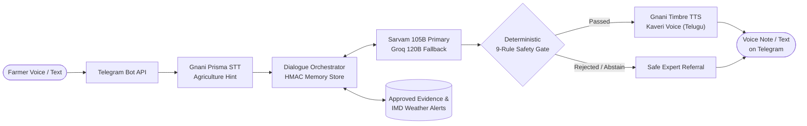

# కృషివాణి KrishiVaani
### *Voice-first AI agricultural assistant for Indian farmers*

[](https://www.python.org/)
[](https://t.me/KrishiVaaniBot)
[](https://gnani.ai/)
[](https://sarvam.ai/)
[](https://railway.com/)

- **What it does**: Voice-first AI assistant for farmers across India in multiple languages, with verified, expert-reviewed depth for Telangana first.
- **Who it is for**: Smallholder farmers who prefer conversational speech over complex text portals, featuring a Telugu voice-first identity.
- **How farmers use it**: Send a voice note or text on Telegram in any supported language, ask about crops, pests, or weather, and receive a spoken voice reply (Telugu) or text response.

---

## Try it / Demo

- 🎬 **Demo post (LinkedIn)**: https://lnkd.in/p/dfKzXneH
- 🤖 **Telegram Bot**: [@KrishiVaaniBot](https://t.me/KrishiVaaniBot)
- 🌐 **Project Showcase**: [krishivaani1.netlify.app](https://krishivaani1.netlify.app/)

---

## Coverage & Languages

The bot recognizes 10 languages: Telugu (`te-IN`), Hindi (`hi-IN`), English (`en-IN`), Kannada (`kn-IN`), Tamil (`ta-IN`), Marathi (`mr-IN`), Malayalam (`ml-IN`), Punjabi (`pa-IN`), Bengali (`bn-IN`), and Gujarati (`gu-IN`).
- **Speech Input (STT)**: Accepts voice notes in all 10 languages via Gnani Prisma v3.0 (with agriculture topic hint).
- **Spoken Voice Output (TTS)**: **Telugu-only** (Kaveri voice via Gnani Timbre v2.5). Non-Telugu queries receive localized text replies.

| Region | Supported Languages | Available Capabilities |
| :--- | :--- | :--- |
| **Telangana** | Any of 10 languages | LLM guidance, general explanations, live weather & IMD warnings, and answers grounded in the Telangana knowledge base. |
| **Other States** | Any of 10 languages | LLM general guidance, general explanations, live weather (with consent), and referrals to Kisan Call Centre (1800-180-1551), state agriculture departments, KVKs, and IMD advisories. No unverified chemical, dosage, or crop prescriptions. |

*In progress: grounded, guardrailed data for other states.*

---

## How Answers Are Grounded

KrishiVaani evaluates queries across three strict tiers ([details](docs/safety-and-knowledge.md)):
1. **Tier 1 (General Knowledge)**: Educational/conceptual questions (e.g. *"What is drip irrigation?"*, *"What is El Niño?"*) answered from general LLM knowledge in concise conversational sentences without requiring local bulletins.
2. **Tier 2 (Live Meteorological Data)**: Current conditions, 3-day forecasts, and IMD rainfall warnings retrieved from WeatherAPI and official IMD bulletins with explicit user consent.
3. **Tier 3 (Consequential Farm Actions)**: Chemical spray recommendations, fertilizer dosages, seed varieties, and government schemes strictly require valid, expert-approved evidence; otherwise, the system abstains fail-closed.

---

## Telangana Data & Ingestion

Sourced from **PJTSAU agromet bulletins**, **TGDPS weather reports**, and **IMD district warnings**.
- **Ingestion Tools**: Bulletins are discovered, downloaded, and extracted via manual CLI tools (`python -m app.knowledge.pjtau.cli` and `tgdps.cli`) using PyMuPDF and pdfplumber. Ingestion does not run on an automated schedule.
- **Review Lifecycle**: New items enter as `pending_verification`, move to `verified` after technical extraction checks, and require `approved` status from a qualified agricultural expert to become retrievable.
- **Seed Status**: In `data_seed/krishivaani.db`, 50 items are `verified` (developer-reviewed for syntax/schema) and 1 item is `approved` (temporally expired); 0 currently valid approved items exist today. Unapproved or expired crop advisories safely trigger expert referrals.

---

## How It Works



---

## Engineering Highlights

- **Deterministic 9-Rule Safety Gate**: Evaluates every completion in Python prior to speech synthesis, actively intercepting ungrounded chemical dosages, unverified scheme claims, and expired advisories.
- **Expert-Approval Knowledge Gating**: Enforces an auditable three-stage review lifecycle (`pending_verification` $\to$ `verified` $\to$ `approved`); only agricultural-expert approved, valid evidence reaches the prompt context.
- **Sarvam 105B Primary with Automatic Groq Fallback**: Uses `sarvam-105b-conversations` optimized for Indian regional languages, automatically failing over to Groq Cloud (`openai/gpt-oss-120b`) on provider errors.
- **Privacy-Preserving Conversation Memory**: Retains the last 4 conversation turns and profile attributes in SQLite keyed strictly by an HMAC-SHA256 salted hash of the user ID (never storing raw Telegram IDs); cleared instantly via `/forget`.
- **Consent-Gated Weather & IMD Warnings**: Requires affirmative user consent before querying external weather APIs; routes severe rainfall warnings through official IMD district bulletins.
- **452 Automated Tests**: Verified test suite covering speech validation, dialogue orchestration, safety gating, and ingestion state machines.

---

## Tech Stack

| Layer | Technology | Role in KrishiVaani |
| :--- | :--- | :--- |
| **Speech STT & TTS** | Gnani Prisma v3.0 & Timbre v2.5 | Telugu speech recognition (with agriculture topic hint) and synthesis (Kaveri voice) |
| **Primary LLM** | Sarvam AI (`sarvam-105b-conversations`) | Multilingual dialogue reasoning grounded strictly in evidence |
| **Fallback LLM** | Groq Cloud (`openai/gpt-oss-120b`) | Automatic fallback inference upon primary provider failure |
| **Bot Channel** | `python-telegram-bot` (v22.8) | Asynchronous Telegram long-polling (no public webhooks required) |
| **Backend & DB** | Python 3.11, FastAPI, SQLite3 (WAL) | Core orchestration, audit trails, and evidence retrieval |
| **Weather & Alerts** | WeatherAPI.com & IMD Adapter | District-level 3-day forecasts and official district meteorological alerts |
| **Hosting** | Railway (Docker) & Netlify | Containerized app on persistent volume; static marketing site |

---

## Quick Start

```bash
git clone https://github.com/Siddhartha23i/KrishiVaani.git && cd KrishiVaani
python -m venv venv && source venv/bin/activate  # Windows: .\venv\Scripts\Activate.ps1
pip install -r requirements.txt
cp .env.example .env  # Configure TELEGRAM_BOT_TOKEN, SARVAM_API_KEY, USER_ID_HASH_SALT, GNANI_API_KEY
python -m app.telegram.run
```

---

## Detailed Documentation

- [docs/configuration.md](docs/configuration.md): Complete environment variables, defaults, and configuration options.
- [docs/safety-and-knowledge.md](docs/safety-and-knowledge.md): 9-rule safety validator, review lifecycle, and seed database audit.
- [docs/memory-and-privacy.md](docs/memory-and-privacy.md): HMAC salted user hashing, 4-turn context memory, and `/forget` erasure.
- [docs/deployment/railway_deployment_guide.md](docs/deployment/railway_deployment_guide.md): Production container deployment and persistent volume setup on Railway.

---

## Known Limitations

| Component | Current Scope / Limitation |
| :--- | :--- |
| **Geographic Evidence** | Verified knowledge is Telangana-only today; other states use general guidance plus live weather. *In progress: grounded, guardrailed data for other states.* |
| **Crop & Pest Advice** | Consequential guidance requires expert-approved evidence. Today's seed DB has 50 `verified` and 1 expired `approved` item; crop chemical questions safely refer to the local Agricultural Officer (AO) or KVK. |
| **Voice Replies** | Voice synthesis is currently Telugu-only (Kaveri voice); other languages receive text replies. |
| **Seed Updates** | Container entrypoint preserves existing Railway volumes and does not auto-sync newly updated seed items. |

---

## Roadmap

- *In progress: grounded, guardrailed data for other states.*
- Complete expert agronomic review to activate the remaining 50 PJTSAU advisories in seed storage.
- Expand voice synthesis to Hindi and Kannada.
- Implement an automated non-destructive database synchronizer for Railway persistent volumes.

---

## Acknowledgements & Author

- **Acknowledgements**: Built with **Gnani AI** (Prisma STT, Timbre TTS), **Sarvam AI** (`sarvam-105b-conversations`), **Groq Cloud** (`openai/gpt-oss-120b`), **PJTSAU**, **TGDPS**, and **IMD**.
- **Author**: **Ambaigari Siddhartha Reddy** — [LinkedIn Profile](https://lnkd.in/p/dRGitDph) (Built for the **Gnani AI Great Indian AI Internship Challenge**).
