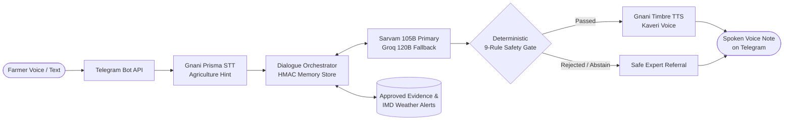

# కృషివాణి KrishiVaani
### *Voice-first AI agricultural assistant for Indian farmers*

[](https://www.python.org/)
[](https://t.me/KrishiVaaniBot)
[](https://gnani.ai/)
[](https://sarvam.ai/)
[](https://railway.com/)

- **What it does**: Listens to spoken Telugu agricultural queries, retrieves verified university research, and replies with natural synthesized Telugu speech.
- **Who it is for**: Smallholder farmers in Telangana who encounter literacy or linguistic barriers with text-heavy advisory portals.
- **How farmers use it**: Send a voice note or text on Telegram, ask about crop health, pests, or weather forecasts, and receive a spoken voice reply.

---

## Try it / Demo

- 🎬 **Demo post (LinkedIn)**: https://lnkd.in/p/dfKzXneH
- 🤖 **Telegram Bot**: [@KrishiVaaniBot](https://t.me/KrishiVaaniBot)
- 🌐 **Project Showcase**: [krishivaani1.netlify.app](https://krishivaani1.netlify.app/)

---

## How It Works



---

## Engineering Highlights

- **Deterministic 9-Rule Safety Gate**: Evaluates every completion in Python prior to speech synthesis, actively intercepting ungrounded chemical dosages, unverified scheme claims, and expired advisories.
- **Expert-Approval Knowledge Gating**: Enforces an auditable three-stage review lifecycle (`pending_verification` $\to$ `verified` $\to$ `approved`); only agricultural-expert approved, valid evidence reaches the prompt context.
- **Sarvam 105B Primary with Automatic Groq Fallback**: Uses `sarvam-105b-conversations` optimized for Indian regional languages, automatically failing over to Groq Cloud (`openai/gpt-oss-120b`) on provider errors.
- **Privacy-Preserving Conversation Memory**: Retains the last 4 conversation turns and profile attributes in SQLite keyed strictly by an HMAC-SHA256 salted hash of the user ID (never storing raw Telegram IDs); cleared instantly via `/forget`.
- **Consent-Gated Weather & IMD Warnings**: Requires affirmative user consent before querying external weather APIs; routes severe rainfall warnings through official IMD district bulletins.
- **452 Automated Tests**: Verified test suite covering speech validation, dialogue orchestration, safety gating, and ingestion state machines.

---

## Tech Stack

| Layer | Technology | Role in KrishiVaani |
| :--- | :--- | :--- |
| **Speech STT & TTS** | Gnani Prisma v3.0 & Timbre v2.5 | Telugu speech recognition (with agriculture topic hint) and synthesis (Kaveri voice) |
| **Primary LLM** | Sarvam AI (`sarvam-105b-conversations`) | Multilingual dialogue reasoning grounded strictly in evidence |
| **Fallback LLM** | Groq Cloud (`openai/gpt-oss-120b`) | Automatic fallback inference upon primary provider failure |
| **Bot Channel** | `python-telegram-bot` (v22.8) | Asynchronous Telegram long-polling (no public webhooks required) |
| **Backend & DB** | Python 3.11, FastAPI, SQLite3 (WAL) | Core orchestration, audit trails, and evidence retrieval |
| **Weather & Alerts** | WeatherAPI.com & IMD Adapter | District-level 3-day forecasts and official district meteorological alerts |
| **Hosting** | Railway (Docker) & Netlify | Containerized app on persistent volume; static marketing site |

---

## Quick Start

```bash
git clone https://github.com/Siddhartha23i/KrishiVaani.git && cd KrishiVaani
python -m venv venv && source venv/bin/activate  # Windows: .\venv\Scripts\Activate.ps1
pip install -r requirements.txt
cp .env.example .env  # Configure TELEGRAM_BOT_TOKEN, SARVAM_API_KEY, USER_ID_HASH_SALT, GNANI_API_KEY
python -m app.telegram.run
```

---

## Detailed Documentation

- [docs/configuration.md](docs/configuration.md): Complete environment variables, defaults, and configuration options.
- [docs/safety-and-knowledge.md](docs/safety-and-knowledge.md): 9-rule safety validator, review lifecycle, and seed database audit.
- [docs/memory-and-privacy.md](docs/memory-and-privacy.md): HMAC salted user hashing, 4-turn context memory, and `/forget` erasure.
- [docs/deployment/railway_deployment_guide.md](docs/deployment/railway_deployment_guide.md): Production container deployment and persistent volume setup on Railway.

---

## Known Limitations

| Component | Current Scope / Limitation |
| :--- | :--- |
| **Crop & Pest Advice** | Consequential guidance requires expert-approved evidence. Today's seed DB has 50 `verified` and 1 expired `approved` item; crop chemical questions safely refer to the local Agricultural Officer (AO) or KVK. |
| **Voice Replies** | Voice synthesis is currently Telugu-only (Kaveri voice); other languages receive text replies. |
| **Geographic Scope** | Knowledge base and administrative divisions cover Telangana only. |
| **Seed Updates** | Container entrypoint preserves existing Railway volumes and does not auto-sync newly updated seed items. |

---

## Roadmap

- Complete expert agronomic review to activate the remaining 50 PJTSAU advisories in seed storage.
- Expand voice synthesis to Hindi and Kannada.
- Implement an automated non-destructive database synchronizer for Railway persistent volumes.

---

## Acknowledgements

- **Gnani AI** for Prisma v3.0 STT and Timbre v2.5 TTS voice technology.
- **Sarvam AI** for `sarvam-105b-conversations` Indian-language LLM inference.
- **Groq Cloud** for ultra-low latency fallback inference with `openai/gpt-oss-120b`.
- **PJTSAU** and **TGDPS** for public agricultural research bulletins and agromet data.
- **India Meteorological Department (IMD)** for public weather warning bulletins.

---

## Author

**Ambaigari Siddhartha Reddy** — [LinkedIn Profile](https://lnkd.in/p/dRGitDph)  
Built for the **Gnani AI Great Indian AI Internship Challenge**.
