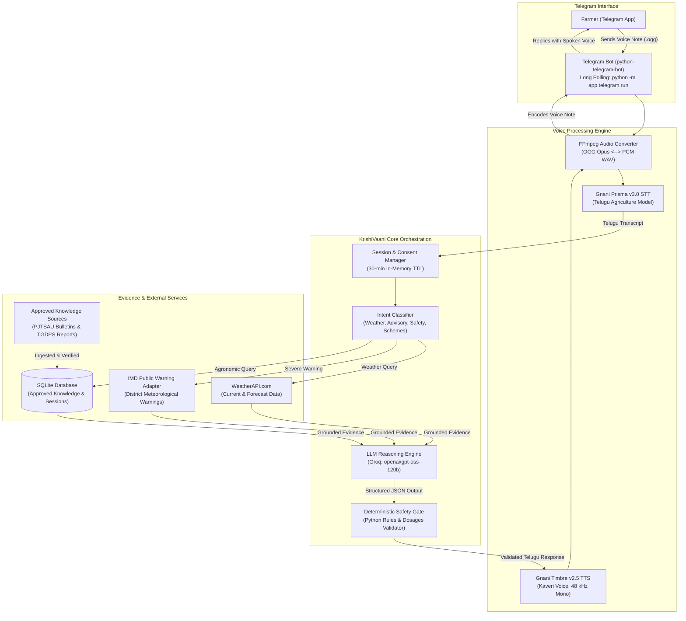

# KrishiVaani (కృషీవాణి)
### *AI-Powered Agricultural Voice Assistant for Indian Farmers*

[](https://www.python.org/)
[-2CA5E0.svg?logo=telegram&logoColor=white)](https://core.telegram.org/bots/api)
[](https://gnani.ai/)
[](https://groq.com/)
[-9b51e0.svg)](https://railway.com/)

**KrishiVaani** is a Telugu-first conversational voice assistant engineered to bridge the critical information gap for smallholder farmers in rural Telangana. The assistant identifies itself as **కృషివాణి** and is not a farmer. By accepting natural spoken voice queries over Telegram and responding with synthesized Telugu voice messages, KrishiVaani allows farmers to ask questions about crop health, weather forecasts, rainfall warnings, and government schemes in their native language—without needing to type, navigate complex web portals, or decipher technical bulletins.

The project was developed as part of the **Gnani AI Great Indian AI Internship Challenge**, combining enterprise-grade Indian language speech recognition, deterministic safety guardrails, low-latency LLM reasoning, and verified agronomic research.

---

## Table of Contents

- [The Problem It Solves](#the-problem-it-solves)
- [Key Features](#key-features)
- [How It Works](#how-it-works)
- [System Architecture](#system-architecture)
- [Technology Stack](#technology-stack)
- [Project Structure](#project-structure)
- [Knowledge Management & Safety Architecture](#knowledge-management--safety-architecture)
- [Getting Started Locally](#getting-started-locally)
- [Environment Variables](#environment-variables)
- [Testing](#testing)
- [Production Deployment (Railway)](#production-deployment-railway)
- [Current Scope & Known Limitations](#current-scope--known-limitations)
- [Future Roadmap](#future-roadmap)
- [Acknowledgements](#acknowledgements)

---

## The Problem It Solves

Smallholder farmers in India frequently face preventable crop loss, misinformed fertilizer expenditure, and severe weather risks due to three systemic barriers:

1. **Digital Literacy & Modality Barrier:** Complex mobile applications and text-heavy dashboards are difficult to navigate for rural farmers who rely on spoken communication.
2. **Linguistic & Dialectal Exclusion:** Mainstream agricultural advisory systems often communicate in formal English or standardized Hindi, failing to support conversational regional languages such as Telugu.
3. **Unreliable Advice & Uncontrolled Hallucination:** Informal community advice or ungrounded generative AI models frequently hallucinate hazardous chemical dosages, unverified crop varieties, or outdated advisories, leading to chemical poisoning of soil or total financial crop loss.

**KrishiVaani solves this by:**
- Operating strictly over **voice messages** on **Telegram**.
- Grounding all agricultural answers in **officially approved agricultural documents** from Professor Jayashankar Telangana State Agricultural University (PJTSAU) and Telangana State Development Planning Society (TGDPS).
- Enforcing an **independent deterministic safety layer** that intercepts model outputs before speech synthesis, actively rejecting ungrounded recommendations and referring farmers to their local Agricultural Officer (AO) or Krishi Vigyan Kendra (KVK).

---

## Key Features

- **End-to-End Voice-in, Voice-out Pipeline:**
  Farmers send Telugu voice notes (OGG Opus) on Telegram and receive natural spoken responses powered by Gnani Timbre v2.5 (Kaveri voice).
- **Accurate Telugu Speech Recognition:**
  Leverages Gnani Prisma v3.0 STT tuned with agricultural domain vocabulary and Telangana farming topics to transcribe colloquial queries accurately.
- **Evidence-Grounded AI Reasoning:**
  Uses Groq Cloud (`openai/gpt-oss-120b`) operating at low temperature (`0.1`) with structured JSON schema constraints, reasoning strictly from verified evidence.
- **Deterministic Agricultural Safety Layer:**
  Runs automated post-generation validation checks in Python against 9 safety rules (monitoring prohibited chemical dosages, ungrounded financial claims, invalid geographic applicability, and advisory expiration).
- **Weather Forecasts & IMD Alerts:**
  Retrieves real-time meteorological forecasts via WeatherAPI and layers official color-coded district weather warnings from the India Meteorological Department (IMD).
- **Privacy & Location Minimisation:**
  Requires explicit, recorded consent before querying third-party weather APIs. Stores location context only in temporary in-memory sessions (30-minute TTL) and provides immediate location deletion upon request.
- **Ambiguity & Conflict Resolution:**
  Detects conflicting place names or cross-district mandal references within farmer queries, proactively requesting clarification rather than generating inaccurate forecasts.
- **Graceful Degradation:**
  If voice synthesis or third-party APIs encounter intermittent issues, KrishiVaani cleanly falls back to safe text guidance without dropping the conversation.

---

## How It Works

The request lifecycle executes across distinct processing stages:

```
Farmer Speaks (Telegram Voice Note)
       │
       ▼
1. Audio Validation & Decoding (FFmpeg checks format, size, and <= 30s duration)
       │
       ▼
2. Speech-to-Text (Gnani Prisma v3.0 transcribes Telugu audio to text)
       │
       ▼
3. Intent Routing & Session Management (Identifies weather, agronomy, scheme, or safety inquiry)
       │
       ├─────────────────────────────────┬─────────────────────────────────┐
       ▼                                 ▼                                 ▼
   Weather Inquiry               Agronomic Advisory               Lightning / Safety
(Checks consent & temp loc;      (Retrieves approved PJTSAU/       (Bypasses weather gate;
 fetches WeatherAPI & IMD)        TGDPS records from SQLite)        retrieves PJTSAU rules)
       │                                 │                                 │
       └─────────────────────────────────┼─────────────────────────────────┘
                                         ▼
4. LLM Reasoning (Groq `openai/gpt-oss-120b` synthesizes evidence into conversational Telugu)
                                         │
                                         ▼
5. Deterministic Safety Gate (Validates citations, chemical dosages, expiration, and echoes)
                                         │
                         ┌───────────────┴───────────────┐
                         ▼                               ▼
                     [PASSED]                       [REJECTED]
             Safe synthesized reply           Safe abstention / AO referral
                         │                               │
                         └───────────────┬───────────────┘
                                         ▼
6. Text-to-Speech (Gnani Timbre v2.5 Kaveri voice synthesizes 48 kHz WAV)
                                         │
                                         ▼
7. Encoding & Delivery (Converted to mono OGG Opus; sent as Telegram voice message)
```

---

## System Architecture



---

## Technology Stack

| Component | Technology / Library | Version / Model | Role in KrishiVaani |
| :--- | :--- | :--- | :--- |
| **Language & Runtime** | Python | `3.11.9` | Primary backend language |
| **Bot Framework** | `python-telegram-bot` | `22.8` | Asynchronous Telegram long-polling (no webhooks needed) |
| **Speech-to-Text (STT)** | Gnani AI (`gnani-vachana`) | `Prisma v3.0` | Telugu agricultural speech transcription |
| **Text-to-Speech (TTS)** | Gnani AI (`gnani-vachana`) | `Timbre v2.5` | Natural Telugu speech synthesis (Kaveri voice) |
| **LLM Inference** | Groq Cloud API (`groq`) | `openai/gpt-oss-120b` | Structured factual reasoning with evidence grounding |
| **Meteorological Data** | WeatherAPI.com | `v1` REST API | Short-range temperature, rainfall, and sky conditions |
| **Official Weather Alerts** | IMD Warning Adapter | Beautiful Soup 4 / PyMuPDF | Official district rainfall alerts and safety overlays |
| **Audio Processing** | System FFmpeg & `imageio-ffmpeg` | `0.6.0` | OGG Opus decoding and linear PCM WAV encoding |
| **Database** | SQLite3 | Relational (WAL Mode) | Persistent storage for verified knowledge and consents |
| **Data Validation** | Pydantic & Pydantic-Settings | `2.9.2` / `2.12.0` | Strict schema parsing and environment configuration |
| **Containerization** | Docker | `python:3.11-slim` | Production multi-stage Linux container |
| **Production Host** | Railway | Cloud Platform | Container hosting with persistent storage volumes |

---

## Project Structure

```
Gnani_Project/
├── Dockerfile                      # Production Docker container definition
├── docker-entrypoint.sh            # Persistent volume auto-seeder & entrypoint
├── railway.json                    # Railway deployment & restart configuration
├── railway_deployment_guide.md     # Detailed deployment runbook
├── requirements.txt                # Production Python dependencies
├── .env.example                    # Environment variable documentation template
├── .gitignore                      # Strict exclusion for secrets, runtime data, & audio
│
├── app/                            # Core application source code
│   ├── api/                        # FastAPI endpoints (health, knowledge, diagnostics)
│   ├── conversation/               # Conversation orchestrator, intent router, & schemas
│   │   ├── intent.py               # Multilingual intent classification & lightning safety routing
│   │   ├── schemas.py              # Conversation request/response models
│   │   └── service.py              # Core dialogue management pipeline
│   ├── core/                       # Global configuration and settings
│   │   └── config.py               # Pydantic BaseSettings loading from environment
│   ├── db/                         # Database connection & schema definitions
│   │   ├── database.py             # SQLite lifecycle, table initialization, and migrations
│   │   └── farmer_repository.py    # Farmer profile repository
│   ├── knowledge/                  # Agricultural knowledge base & ingestion
│   │   ├── models.py               # Knowledge item schemas and verification states
│   │   ├── repository.py           # SQLite evidence search and retrieval
│   │   ├── review_service.py       # Knowledge verification review workflow
│   │   ├── pjtau/                  # PJTSAU research stations & advisory extractors
│   │   └── tgdps/                  # TGDPS daily weather report ingestion
│   ├── llm/                        # Large Language Model integration
│   │   ├── config.py               # Groq configuration and model parameters
│   │   ├── safety.py               # Deterministic 9-point agricultural safety validator
│   │   ├── service.py              # LLM reasoning orchestration & system prompts
│   │   └── providers/groq_provider.py # Groq Cloud API wrapper
│   ├── telegram/                   # Telegram Bot Interface (Phase 8.3)
│   │   ├── audio.py                # OGG Opus to WAV audio decoding
│   │   ├── handlers.py             # Start, voice note, text message, & error handlers
│   │   ├── run.py                  # Entrypoint: python -m app.telegram.run
│   │   └── session.py              # User session, consent tracking, & location extraction
│   ├── voice/                      # Voice Pipeline Services
│   │   ├── service.py              # Gnani Prisma STT & Timbre TTS integration
│   │   ├── validator.py            # Audio duration (<= 30s) and payload validation
│   │   └── schemas.py              # Voice processing data models
│   └── weather/                    # Meteorological Intelligence
│       ├── disclaimers.py          # Localized Telugu/Hindi/English legal disclaimers
│       ├── providers/              # WeatherAPI and IMD warning adapters
│       └── services/weather_service.py # Central weather orchestration service
│
├── data_seed/                      # Approved knowledge seeds for volume initialization
│   ├── krishivaani.db              # Sanitized SQLite database with 51 verified items
│   ├── pjtau/raw_pdfs/             # Approved PJTSAU advisory bulletins
│   └── tgdps/raw_pdfs/             # Approved TGDPS daily weather reports
│
└── tests/                          # Automated unit and integration test suite
    ├── test_agricultural_knowledge.py
    ├── test_conversation_orchestration.py
    ├── test_imd_public_warning.py
    ├── test_llm_service.py
    ├── test_telegram_integration.py # 44 tests covering Telegram voice & consent flows
    ├── test_voice_pipeline.py       # 20 tests covering STT, TTS, & duration checks
    └── test_weather_service.py
```

---

## Knowledge Management & Safety Architecture

KrishiVaani's primary ethical mandate is **Farmer Safety and Strict Evidence-Grounded Truth**. Agricultural advice is strictly segregated into verified evidence or explicit abstention.

### 1. Two-Stage Knowledge Approval Pipeline
Agricultural advisories from **PJTSAU** and **TGDPS** enter the system through a structured verification workflow:
1. **Ingestion:** Bulletins are parsed via PyMuPDF and split into structured items tagged with publisher, published date, validity period (`applicable_until`), crop name, district, and mandal.
2. **Draft State:** Ingested items are initially marked as `pending_verification`.
3. **Verification Audit:** Only records explicitly reviewed and signed off by authorized personnel (recorded in `knowledge_verification_audit`) receive `verified` status.
4. **Retrieval Exclusion:** Unverified items, expired advisories, or records outside the farmer's target geography are blocked from entering the LLM prompt.

### 2. The 9 Deterministic Safety Guardrails
Before any LLM-generated text is passed to Gnani Timbre for voice synthesis, [`LLMSafetyValidator`](file:///d:/Sid_Folder/Sid_projects/Gnani_Project/app/llm/safety.py) executes deterministic Python checks:

1. **Unknown Evidence Citation Check:** Verifies that every cited evidence ID exists in the approved retrieved set.
2. **Source Approval Status Check:** Rejects content derived from sources marked `pending_verification` or `rejected`.
3. **Advisory Expiration Check:** Blocks advice from bulletins whose `applicable_until` timestamp has elapsed.
4. **Geographic Applicability Check:** Ensures crop advice tailored to a specific agro-climatic zone is not delivered to farmers outside that zone.
5. **Actionable Crop Recommendation Rule:** If mandatory field parameters (season, soil condition, water source) are missing, prohibits recommending crops and prompts clarifying questions.
6. **Chemical & Dosage Restriction:** Prohibits recommending monitored synthetic chemical pesticides (e.g., monocrotophos, chlorpyrifos) or arbitrary dosage numbers (`ml/L`, `kg/acre`) without explicit approved evidence.
7. **Forecast-Alone Rule:** Prevents weather forecasts alone from triggering irrigation or crop sowing recommendations unless agronomic evidence supports it.
8. **Ungrounded Yield & Financial Claims:** Intercepts fabricated yield claims (`quintals/acre`) or financial promises (`₹ amounts`).
9. **Echo Prevention Guard:** Detects if the model repeated the farmer's question back as an answer, automatically overriding it with a helpful clarification prompt.

> [!IMPORTANT]
> **Safety Abstention Behavior:** When evidence is missing or safety rules are triggered, KrishiVaani delivers a polite Telugu voice response advising the farmer to consult their local **Mandal Agricultural Officer (AO)** or nearest **Krishi Vigyan Kendra (KVK)**.

### 3. Weather Disclaimers & Geographic Precision
Weather forecasts are inherently probabilistic. KrishiVaani includes localized disclaimers explaining that weather predictions are regional estimates and must not be treated as farm-level precision. Official IMD alerts are highlighted with color-coded severity warnings (Yellow, Orange, Red) when available.

---

## Getting Started Locally

### Prerequisites

1. **Python 3.11** installed on your system.
2. **System FFmpeg** installed and accessible on your system `PATH` (required for Telegram voice note decoding).
   - *Windows:* Install via `winget install Gyan.FFmpeg` or download from [gyan.dev](https://www.gyan.dev/ffmpeg/builds/).
   - *Ubuntu/Debian:* `sudo apt update && sudo apt install -y ffmpeg`
   - *macOS:* `brew install ffmpeg`
3. **API Keys:**
   - Telegram Bot Token (from [@BotFather](https://t.me/BotFather))
   - Groq Cloud API Key (from [Groq Console](https://console.groq.com/))
   - Gnani AI API Key (from [Gnani.ai](https://gnani.ai/))
   - WeatherAPI Key (from [WeatherAPI.com](https://www.weatherapi.com/))

### Installation Steps

1. **Clone the Repository:**
   ```bash
   git clone https://github.com/Siddhartha23i/KrishiVaani.git
   cd KrishiVaani
   ```

2. **Create and Activate a Virtual Environment:**
   ```bash
   # Windows (PowerShell)
   python -m venv .venv
   .venv\Scripts\Activate.ps1

   # Linux / macOS
   python3.11 -m venv .venv
   source .venv/bin/activate
   ```

3. **Install Dependencies:**
   ```bash
   pip install --upgrade pip
   pip install -r requirements.txt
   ```

4. **Configure Environment Variables:**
   ```bash
   # Copy template
   cp .env.example .env
   ```
   Edit `.env` and provide your API keys:
   ```env
   TELEGRAM_BOT_TOKEN=123456789:ABCdefGHIjklMNOpqrsTUVwxyz
   GROQ_API_KEY=gsk_...
   GNANI_API_KEY=...
   WEATHERAPI_API_KEY=...
   ```

5. **Start the KrishiVaani Telegram Bot:**
   ```bash
   python -m app.telegram.run
   ```
   You will see:
   ```text
   INFO - Database and schema verified successfully.
   INFO - Starting KrishiVaani Telegram bot polling...
   ```

6. **Test the Bot in Telegram:**
   - Open Telegram and search for your bot's username.
   - Send `/start` to receive the localized Telugu onboarding message.
   - Send a voice note asking a question in Telugu:
     *"నమస్తే , రేపు నిజామాబాద్ లో వర్షం పడుతుందా?"*
   - Listen to the bot's spoken Telugu reply.

---

## Environment Variables

KrishiVaani uses Pydantic-Settings to load configuration from environment variables or a `.env` file.

| Variable Name | Required | Default Value | Description |
| :--- | :---: | :--- | :--- |
| `TELEGRAM_BOT_TOKEN` | **Yes** | *None* | Bot authentication token provided by [@BotFather](https://t.me/BotFather). |
| `USER_ID_HASH_SALT` | **Yes for Telegram memory** | *None* | Secret salt used to HMAC-hash Telegram user ids before storage. |
| `GROQ_API_KEY` | **Yes** | *None* | API key for Groq Cloud LLM inference. |
| `GNANI_API_KEY` | **Yes** | *None* | Unified API key for Gnani Prisma STT and Timbre TTS platforms. |
| `WEATHERAPI_API_KEY` | **Yes** | *None* | API key for WeatherAPI.com forecast services. |
| `LLM_PROVIDER` | No | `sarvam` | Active LLM provider: `sarvam` or `groq`. Sarvam falls back to Groq once on provider failure. |
| `SARVAM_API_KEY` | When `LLM_PROVIDER=sarvam` | *None* | API key for Sarvam chat completions. |
| `SARVAM_MODEL` | No | `sarvam-105b-conversations` | Sarvam model identifier. |
| `GROQ_MODEL_ID` | No | `openai/gpt-oss-120b` | Approved reasoning model ID on Groq Cloud. |
| `GROQ_TEMPERATURE` | No | `0.1` | Sampling temperature (kept low for factual evidence compliance). |
| `GROQ_MAX_TOKENS` | No | `1200` | Maximum token allocation for Groq structured JSON output. |
| `GROQ_REASONING_EFFORT` | No | `low` | Groq reasoning effort. |
| `SARVAM_MAX_TOKENS` | No | `900` | Maximum token allocation for Sarvam structured JSON output. |
| `SARVAM_LENGTH_RETRY_MULTIPLIER` | No | `1.5` | Multiplier for one retry when Sarvam truncates a response. |
| `GROQ_REQUEST_TIMEOUT_SECONDS` | No | `15.0` | Timeout in seconds for LLM completions. |
| `DATABASE_PATH` | No | `data/krishivaani.db` | Path to persistent SQLite database (`/app/data/krishivaani.db` in Docker). |
| `WEATHERAPI_BASE_URL` | No | `https://api.weatherapi.com/v1` | WeatherAPI base endpoint URL. |
| `WEATHER_REQUEST_TIMEOUT_SECONDS` | No | `10.0` | Timeout in seconds for meteorological queries. |
| `IMD_API_KEY` | No | *None* | Optional API key for direct IMD district feeds. |
| `IMD_JWT_TOKEN` | No | *None* | Optional JWT token for authenticated IMD alert services. |
| `DEBUG` | No | `False` | Enables detailed debugging logs. |

---

## Telegram conversation memory

Telegram memory is stored in the existing SQLite database on the Railway volume. The
`ConversationMemoryStore` creates one indexed `chat_turns` table and stores only an
HMAC-SHA256 hash of the Telegram user id; raw Telegram ids, phone numbers, names, and
audio are not stored by this feature. Set `USER_ID_HASH_SALT` in Railway to a long,
random secret value. The application fails clearly when memory is used without it.

Before each Telegram LLM request, the bot supplies the last four successful turns
(trimmed to about 400 characters) and the remembered farmer context through the
existing `FarmerContextSchema` prompt slot. This context is not evidence, and
time-sensitive facts are rechecked against current evidence. Abstentions, rejected
responses, and technical fallbacks are not saved. Saves happen after the reply in a
background task, so a database failure cannot block delivery.

The `/start` message explains memory and `/forget` deletes the user's stored turns
and profile snapshot. Existing weather consent and temporary location rules remain
unchanged; a remembered district is only reused as context and never grants weather
provider consent.

**Railway variable to add:** `USER_ID_HASH_SALT` (generate a unique random secret
for this deployment and keep it out of source control).

---

## Languages and out-of-state requests

Use `/language` to choose Telugu, Hindi, or English; the choice is stored per
user and applies to subsequent text and voice requests. Devanagari text is also
used as a Hindi hint when no preference exists. Timbre is currently configured
for Telugu voice output, so unsupported voice languages are returned as text.

For a consented, known location outside Telangana, the bot can provide live
WeatherAPI weather for that location. It never uses Telangana crop, pest, or
scheme evidence for another state. Crop-specific questions outside the verified
knowledge base receive a localized referral to Kisan Call Centre
`1800-180-1551`, the state agriculture department or nearest KVK, and IMD
district agromet advisories (Mausam/Meghdoot). Any general tips are explicitly
labelled general and are non-prescriptive.

---

## Testing

The codebase includes automated unit and integration tests. External APIs (Telegram, Groq, Gnani, WeatherAPI) are mocked in tests to verify deterministic logic, state management, and safety boundaries without incurring API costs.

> [!NOTE]
> Mocked unit tests validate routing logic, schema integrity, and error handling. They do not simulate live network latencies or upstream provider outages.

### Running Test Suites

Run all tests:
```bash
pytest
```

Run specific test modules:
```bash
# Telegram integration, session, & consent flows (44 tests)
pytest tests/test_telegram_integration.py -v

# Voice pipeline, STT/TTS mocking, & duration validation (20 tests)
pytest tests/test_voice_pipeline.py -v

# Deterministic safety layer & evidence grounding
pytest tests/test_llm_service.py -v

# Weather services & IMD public warning overlays
pytest tests/test_weather_service.py -v
pytest tests/test_imd_public_warning.py -v

# Knowledge base ingestion & verification workflow
pytest tests/test_agricultural_knowledge.py -v
pytest tests/test_review_workflow.py -v
```

---

## Production Deployment (Railway)

KrishiVaani is fully configured for continuous deployment on **Railway** via Docker. The bot runs in asynchronous long-polling mode, which eliminates the need for open public ports, incoming webhooks, or SSL certificates.

### 1. Railway Architecture Configuration

- **Builder:** Dockerfile (`python:3.11-slim`) with Debian system FFmpeg.
- **Start Command:** `python -m app.telegram.run`
- **Volume Mount:** Attach a persistent volume at `/app/data`.
- **Restart Policy:** `ON_FAILURE` (max 10 retries) via [`railway.json`](file:///d:/Sid_Folder/Sid_projects/Gnani_Project/railway.json).
- **Safe Database Initialization:** [`docker-entrypoint.sh`](file:///d:/Sid_Folder/Sid_projects/Gnani_Project/docker-entrypoint.sh) copies approved seed knowledge from `/app/data_seed/krishivaani.db` on first boot. On subsequent restarts or redeployments, it preserves all live session and consent records without overwriting.

### 2. Step-by-Step Deployment Guide

1. **Push Repository to GitHub:**
   Ensure your changes are committed and pushed to your private GitHub repository:
   ```bash
   git push -u origin main
   ```
2. **Create New Project on Railway:**
   - Log in to your [Railway Dashboard](https://railway.com/dashboard).
   - Click **+ New Project** → **Deploy from GitHub repo**.
   - Select `Siddhartha23i/KrishiVaani`.
3. **Attach Persistent Storage Volume:**
   - In your Railway service canvas, navigate to the **Volumes** tab.
   - Click **+ Add Volume**.
   - Set the Mount Path to:
     ```text
     /app/data
     ```
4. **Configure Environment Variables:**
   In the **Variables** tab of your service, add your credentials:
   - `TELEGRAM_BOT_TOKEN`
   - `GROQ_API_KEY`
   - `GNANI_API_KEY`
   - `WEATHERAPI_API_KEY`
   - `DATABASE_PATH=/app/data/krishivaani.db`
5. **Deploy & Verify:**
   Railway builds the container and launches the bot. Open the **Deploy Logs** to verify startup:
   ```text
   [KrishiVaani] Volume initialization complete. Executing command: python -m app.telegram.run
   INFO - Database and schema verified successfully.
   INFO - Starting KrishiVaani Telegram bot polling...
   ```

---

## Current Scope & Known Limitations

| Capability | Current Status | Description & Operational Scope |
| :--- | :---: | :--- |
| **Telegram Channel** | **Active / Production Ready** | Fully functional voice-in, voice-out long-polling interface on Telegram. |
| **Audio Duration Limit** | **Enforced (<= 30s)** | Voice notes exceeding 30 seconds are rejected with polite Telugu guidance to prevent processing timeouts. |
| **Geographic Coverage** | **Telangana Focus** | Knowledge items and district mappings are tailored to the 33 districts of Telangana. |
| **Historical Weather** | **Not Supported** | Focuses on current weather and 1-3 day short-range forecasts; does not compute historical crop models. |
| **Chemical Prescriptions** | **Strictly Prohibited** | Never dispenses unverified chemical pesticide or fungicide spray dosages; always refers to local AOs/KVKs. |

---

## Future Roadmap

The following enhancements are planned for subsequent phases:

- [ ] **Automated Bulletin Crawler:** Scheduled background crawlers to ingest and draft weekly PJTSAU district agromet bulletins as soon as they are published.
- [ ] **Hybrid Dense-Sparse RAG:** Integrate FAISS vector indexing alongside SQLite relational filtering for semantic search across comprehensive PJTSAU agricultural crop production handbooks.
- [ ] **Interactive Voice Response (IVR) Support:** Extend Gnani speech pipelines to standard telephony (PSTN) for farmers without smartphones.
- [ ] **Expansion to Andhra Pradesh:** Map the 26 districts of Andhra Pradesh with regional weather monitoring and ANGRAU agronomic recommendations.

---

## Acknowledgements

- **Gnani AI:** For providing the speech infrastructure (Prisma v3.0 STT & Timbre v2.5 TTS) and hosting the **Great Indian AI Internship Challenge**.
- **Professor Jayashankar Telangana State Agricultural University (PJTSAU):** For open agricultural research and agro-climatic advisories published for Telangana farmers.
- **Telangana State Development Planning Society (TGDPS):** For automated weather station network reports and district rainfall statistics.
- **India Meteorological Department (IMD):** For official meteorological warning bulletins and nowcasts.
- **Groq:** For providing ultra-low-latency LPU inference powering the `openai/gpt-oss-120b` reasoning engine.

---

*Developed with pride for Indian agriculture.*
